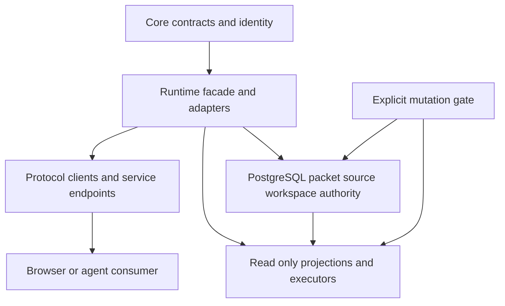
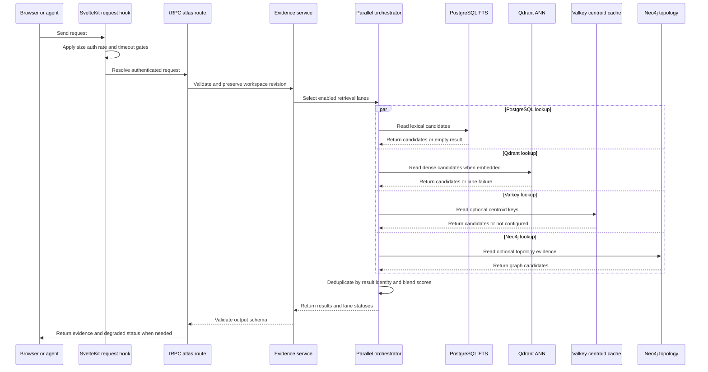
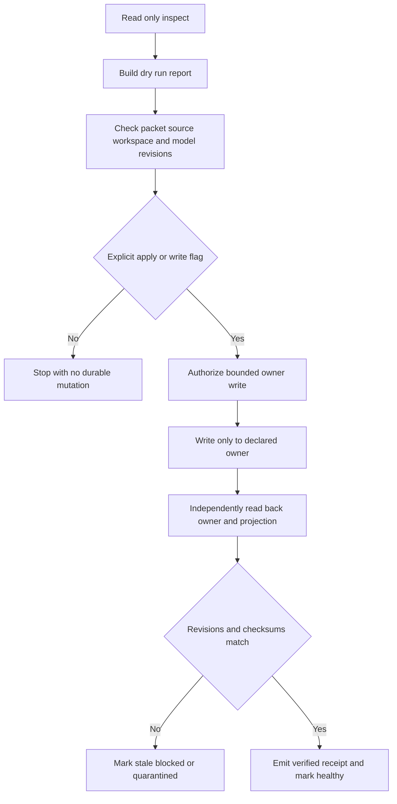

# Ownership, Authority, and Write Boundaries

Parent Atlas has two rules that should govern every integration:

1. **A transport, cache, index, graph, queue, or executor can carry or derive Atlas data without becoming its owner.**
2. **No mutation is implied by a read, a dry-run, a receipt, or a successful computation.** Mutation requires an explicit owner, an explicit apply gate, authorization, and independent verification.

This page is a change-planning map rather than a claim that every proposed registry or service is live. **Proven** means repository code, tests, or an accepted contract support the behavior. **Proposed** means a design direction that is not yet a usable guarantee. **Blocked** means explicitly prohibited or gated. **Unknown** means a live-schema or implementation decision is still required.

The related [Packet Identity and Provenance](../concepts/packet-identity-and-provenance.md) page explains the identity vocabulary, while [Packet Registry](../concepts/packet-registry.md) covers the registry proposal. This page answers the ownership question: **which component may write what, and what must it prove before a projection is trusted?**

## The dependency direction

The package boundary is intentionally one-way:

- `packages/atlas` owns portable contracts and pure identity helpers. It must not own infrastructure clients, migrations, or CLI behavior.
- `packages/parent-atlas` owns typed domain services and the PostgreSQL, Neo4j, Qdrant, and Valkey adapters, including V2 graph persistence.
- `scripts/atlas` owns operational entrypoints and smoke or migration runners, but imports package exports instead of copying their logic.
- `sveltekit-frontend` owns HTTP and UI integration, Drizzle migrations, and server composition. It does not compute canonical graph authority.

Those rules are stated in `docs/architecture/PARENT_ATLAS_PACKAGE_BOUNDARIES.md#L3-L22`. The machine-readable owner map makes `packages/atlas/lib/packet-registry.mjs` the packet-registry owner, forbids script mirrors, and requires runtime imports of the declared package exports (`scripts/atlas/atlas-package-boundaries.json#L1-L31`). The verifier checks package exports, owner paths, forbidden mirrors, required imports, and runtime imports before reporting package-boundary readiness (`scripts/atlas/verify-atlas-package-boundaries.mjs#L11-L55`).

At the retrieval architecture level, the layers are:

- **Core contracts**: JSON-serializable retrieval, policy, identity, context, and provenance types with no HTTP, gRPC, MCP, A2A, SvelteKit, or Vercel AI SDK imports (`docs/PARENT-ATLAS-SYSTEM-BOUNDARIES.md#L30-L56`).
- **Runtime and adapters**: the infrastructure-backed implementation. It may call PostgreSQL, Qdrant, and Neo4j through adapters, and owns identity resolution, fusion, and retrieval orchestration; it does not own protocol handling (`docs/PARENT-ATLAS-SYSTEM-BOUNDARIES.md#L59-L88`).
- **Protocol clients and service endpoints**: transport, retries, timeouts, authorization, and telemetry. Clients depend on contracts, not runtime implementation, and must not implement ranking, deduplication, or graph traversal (`docs/PARENT-ATLAS-SYSTEM-BOUNDARIES.md#L92-L117`, `docs/PARENT-ATLAS-SYSTEM-BOUNDARIES.md#L150-L173`).
- **Agent wrappers**: tool translation, allowlists, and authorization. They consume clients and contracts instead of calling the runtime directly (`docs/PARENT-ATLAS-SYSTEM-BOUNDARIES.md#L121-L147`).

The result is **core → runtime → transport-facing consumers**, not a bidirectional service mesh. Replacing REST, gRPC, MCP, or A2A should not change retrieval semantics. ACP and A2A may expose Atlas to other clients, but the agentic-runtime specification keeps canonical workflow contracts framework-neutral and keeps MCP mutations auditable and policy controlled (`openspec/specs/openspec/specs/parent-atlas-agentic-runtime/spec.md#L117-L159`).

*Caption: The proven dependency direction separates contracts and runtime behavior from transport consumers, canonical PostgreSQL state, and rebuildable projections.*

## What owns canonical state?

### PostgreSQL packet authority

`atlas_packets` is the packet identity spine. The schema explicitly labels PostgreSQL as truth and gives the table durable identity fields such as `packet_id`, `packet_key`, `source_ref`, `feature_id`, `tree_node_id`, and `title_id` (`sveltekit-frontend/src/lib/server/db/schema/atlas-packets.ts#L30-L45`, `sveltekit-frontend/src/lib/server/db/schema/atlas-packets.ts#L132-L143`). It also carries the packet's content hash, source revision, workspace identity and revision, representation revision, embedding lineage, and Qdrant identity as distinct fields (`sveltekit-frontend/src/lib/server/db/schema/atlas-packets.ts#L63-L76`, `sveltekit-frontend/src/lib/server/db/schema/atlas-packets.ts#L102-L140`). Those fields are joins and lineage anchors; the presence of `qdrant_point_id`, `neo4j_node_id`, or `redis_centroid_key` in PostgreSQL does not transfer authority to those systems.

The source authority is also relational and layered. The acquisition schema deliberately keeps research-run, fetch, fetch-attempt, source-revision, and extraction identities separate. A source revision is digest-deduplicated, while a fetch attempt may be new for a reused source revision and an extraction may vary by extractor (`sveltekit-frontend/src/lib/server/db/schema/atlas-acquisition.ts#L3-L15`, `sveltekit-frontend/src/lib/server/db/schema/atlas-acquisition.ts#L50-L125`). Do not collapse those identities into a Qdrant point, a file name, or a workflow run ID.

Workspace authority is revision-qualified. `atlas_workspace_events` records a base snapshot, previous head, new head, event checksum, before and after checksums, and producer revision; `atlas_workspace_heads` records the current head and last event linkage (`sveltekit-frontend/src/lib/server/db/schema/workspace-events.ts#L11-L40`, `sveltekit-frontend/src/lib/server/db/schema/workspace-events.ts#L63-L80`). The same file explicitly says the SQL sidecar remains the migration authority and declares its mirror `applied: false` and `writesPerformed: false` (`sveltekit-frontend/src/lib/server/db/schema/workspace-events.ts#L5-L9`, `sveltekit-frontend/src/lib/server/db/schema/workspace-events.ts#L89-L95`). Those flags are important: a TypeScript schema mirror is not proof that the sidecar has been applied to a live database.

### What the other stores are allowed to be

The data-spine contract names the split directly: cold originals are immutable files or archives, warm packets point back to cold originals, hot cache is active task memory, queues are pending work, PostgreSQL is the truth table and packet registry, and Qdrant is semantic lookup (`docs/atlas/parent-atlas-data-spine.md#L23-L41`). The same contract keeps `.okf`, MsgPack, Arrow IPC, gRPC or protobuf, and Redis or BitFrost in contract, codec, batch, service, cache, or replay lanes rather than promoting them to identity stores (`docs/atlas/parent-atlas-data-spine.md#L32-L55`).

| Surface | Allowed responsibility | Authority status |
|---|---|---|
| PostgreSQL `atlas_packets` and source/workspace owners | Durable packet identity, source lineage, workspace revisions, provenance, and canonical retrieval records | **Proven canonical authority** |
| PostgreSQL BM25 and pgvector | Lexical and vector retrieval lanes backed by PostgreSQL records | **Canonical store lanes**, not independent identity systems |
| Qdrant | Dense or sparse ANN lookup and a projection mirror keyed back to Atlas identity | **Projection only** |
| Neo4j or graph services | Graph-path and topology evidence, bounded expansion, or exported edges | **Derived graph evidence**, not packet ownership |
| Redis or Valkey and BitFrost | Hot cache, centroid lookup, replay, and task memory | **Ephemeral or rebuildable projection** |
| RabbitMQ or other queues | Pending work and delivery | **Work transport**, never source truth |
| Arrow IPC, mmap, MsgPack, `.okf`, RPC, protobuf, and typed JSON | Contract, batch, compact transport, or random-access artifact movement | **Transport or artifact lane** |
| FastAPI, cuVS, RAPIDS, XGBoost, PyTorch, GPU workers | Optional execution or downstream analysis over revisioned inputs | **Executor or derived receipt**, never canonical identity |

The agentic-runtime specification makes the reconciliation rule explicit: if a Kanban, graph, or cache record disagrees with the canonical Atlas record, Atlas wins and the projection is repaired or marked stale (`openspec/specs/openspec/specs/parent-atlas-agentic-runtime/spec.md#L3-L13`). Redis cache presence also does not imply that data enters model context, and KV cache loss must not lose canonical task memory (`openspec/specs/openspec/specs/parent-atlas-agentic-runtime/spec.md#L79-L97`).

## Registry and projection authority

The packet-registry fabric is **not a second packet store**. Its accepted design reuses `atlas_packets` and existing workspace or source revision owners, and permits only a future registry relation whose packet foreign key and revisions resolve back to PostgreSQL truth (`openspec/changes/parent-atlas-rpc-packet-registry-fabric/design.md#L1-L9`, `openspec/changes/parent-atlas-rpc-packet-registry-fabric/design.md#L37-L47`). The OKF registry is likewise a navigation and admission layer: it points to live owners, says not to relocate or copy artifacts, and sets `canonicalAuthority: false` for its fabric (`docs/.okf/registry.yaml#L1-L14`).

The current tRPC surface must be read conservatively. `getPacketRegistry` intentionally returns an unavailable result because the live schema has no canonical `packet_revision` owner or closed packet, source, and AST joins (`sveltekit-frontend/src/lib/server/trpc/routers/atlas.ts#L27-L47`). Its focused test requires `UNAVAILABLE`, `canonicalAuthority: false`, and `writesPerformed: false` (`sveltekit-frontend/src/lib/server/trpc/routers/atlas.spec.ts#L4-L14`). Therefore the registry is **proposed or unavailable**, not an existing authority.

The static lane census is useful observability, not proof of parity. It marks PostgreSQL BM25 as `READY` and `READ_ONLY`, pgvector as `DEGRADED` and `READ_ONLY`, Qdrant as `DEGRADED` and `PROJECTION_ONLY`, and cuVS or FastAPI as `UNPROVEN` and `PROJECTION_ONLY` (`sveltekit-frontend/src/lib/server/atlas/contracts/rpc-packet-registry-lanes-v1.ts#L7-L50`). The registry schema preserves that distinction through explicit lane status, model, representation, collection, index, projection checksum, and write-policy fields (`sveltekit-frontend/src/lib/server/atlas/contracts/rpc-packet-registry-v1.ts#L34-L56`). A lane with a configured collection is not thereby healthy or authoritative.

A registry entry is promotion-eligible only when every lane is `READY` and no lane is `CANONICAL_GATED` (`sveltekit-frontend/src/lib/server/atlas/contracts/rpc-packet-registry-v1.ts#L80-L86`). That is an eligibility predicate, not permission to write. The design still requires independent readback and checksums against PostgreSQL packet and source revisions before a projection is marked healthy (`openspec/changes/parent-atlas-rpc-packet-registry-fabric/design.md#L68-L79`).

## Read and request flow

There are two related but distinct request paths:

1. The architectural service boundary delegates a contract-shaped request from an HTTP, gRPC, MCP, or A2A adapter to a retrieval facade. Protocol code does not rank or traverse the graph (`docs/PARENT-ATLAS-SYSTEM-BOUNDARIES.md#L177-L192`, `docs/PARENT-ATLAS-SYSTEM-BOUNDARIES.md#L217-L238`).
2. The current SvelteKit implementation exposes `retrieveEvidence` through tRPC. The service validates input, preserves `workspaceRevision`, optionally embeds the query, selects lanes, and calls `parallelRetrieve`; the router converts backend failures to a schema-valid degraded response (`sveltekit-frontend/src/lib/server/parent-atlas/precall/retrieve-evidence-service.ts#L59-L116`, `sveltekit-frontend/src/lib/server/trpc/routers/atlas.ts#L49-L77`).

*Caption: The current request path fans out to optional retrieval lanes, aggregates independently, and returns lane status without turning any lane into an identity authority.*

The implementation uses `Promise.allSettled` so one lane can fail without discarding the others, then deduplicates by result ID before score blending and top-K selection (`sveltekit-frontend/src/lib/server/retrieval/parallel-orchestrator.ts#L70-L150`). Optional lanes distinguish `not_configured` from a successful empty search; Redis errors remain lane errors rather than being silently converted into success (`sveltekit-frontend/src/lib/server/retrieval/parallel-orchestrator.ts#L91-L112`, `sveltekit-frontend/src/lib/server/retrieval/parallel-orchestrator.ts#L200-L264`). The older facade contract states the additional architectural invariant: resolve candidates to canonical identity **before** reciprocal-rank fusion, or one packet can rank twice (`docs/PARENT-ATLAS-SYSTEM-BOUNDARIES.md#L284-L310`).

SvelteKit hooks are an entrypoint guard, not a data owner. They assign request IDs, enforce API body limits, rate-limit non-public API requests, validate sessions, deny unauthenticated routes, and require an admin role for `/api/atlas` and other admin surfaces (`sveltekit-frontend/src/hooks.server.ts#L677-L720`, `sveltekit-frontend/src/hooks.server.ts#L722-L877`). They also apply request timeouts while exempting streaming routes and mark non-GET API mutations `no-store` (`sveltekit-frontend/src/hooks.server.ts#L879-L933`, `sveltekit-frontend/src/hooks.server.ts#L1019-L1029`). Authorization and caching policy at this boundary do not grant a handler permission to rewrite PostgreSQL, Qdrant, Neo4j, or Valkey.

## Mutation gates and lifecycle

### Required gate sequence

A safe mutation has five separately observable stages:

1. **Read-only inspection**: identify the owning PostgreSQL row or revision and inspect the proposed target. Do not infer authority from a cache hit, point ID, graph node, index row, or RPC response.
2. **Dry-run report**: compute the candidate update, identity tuple, source and workspace revisions, expected projection or artifact checksum, and conflicts without durable writes. Dry-run is the default for export, normalization, audit, training-row, registry introspection, and migration planning (`docs/atlas/parent-atlas-data-spine.md#L90-L95`, `docs/atlas/parent-atlas-data-spine.md#L153-L157`).
3. **Explicit apply gate**: a production write needs a deliberate `--write` or equivalent `apply` control, separate authorization, and a bounded owner-specific operation. A successful dry-run is evidence for review, not permission to mutate.
4. **Independent readback**: after a write, reread the owning store independently of the in-memory result. Compare packet, source, workspace, representation, model, collection, index, and producer revisions.
5. **Checksum and receipt gate**: compare source or content hashes, projection checksums, and the declared lineage binding. Only a matching, sealed, revision-qualified result may be marked healthy; otherwise mark it stale, blocked, or quarantined.

*Caption: Every mutation path must pass inspection, dry-run, explicit authorization, independent readback, and checksum verification before health or promotion is asserted.*

The data-spine scripts explicitly require `--write` before external database or vector writes and tell operators not to write from the export scripts by default (`docs/atlas/parent-atlas-data-spine.md#L90-L95`, `docs/atlas/parent-atlas-data-spine.md#L153-L182`). The registry change adds stronger non-goals: no automatic migrations, packet backfills, Qdrant writes, cache warming, model training, promotion, or direct Mastra or LangGraph durable writes (`openspec/changes/parent-atlas-rpc-packet-registry-fabric/design.md#L25-L35`). This wiki research performed no datastore, Graphify, index, service, or workflow operation.

### Narrow writes and identity protection

`packages/atlas/lib/packet-registry.mjs` centralizes `TITLE_GENERATOR_VERSION`, defines the canonical `title:<slug>:<hash8>` shape, and declares `packet_key`, `source_ref`, `feature_id`, `tree_node_id`, and `qdrant_point_id` read-only to title backfills. The declared writable set is only `title_id`, `title_generator_version`, and `updated_at` (`packages/atlas/lib/packet-registry.mjs#L1-L39`). The current title-writer compatibility test is deliberately conservative: known writers are classified, no writer is persistence-eligible, and generator-version drift is surfaced rather than silently accepted (`scripts/atlas/title-writer-compat-v1.test.mjs#L45-L67`).

The same discipline applies to RPC. The semantic-AST contract carries the canonical workspace, packet, source, and content identity tuple plus AST byte spans and parser or grammar revisions, and rejects inverted spans (`sveltekit-frontend/src/lib/server/atlas/contracts/rpc-packet-registry-v1.ts#L21-L30`, `sveltekit-frontend/src/lib/server/atlas/contracts/rpc-packet-registry-v1.ts#L60-L76`). It carries qualified data; it does not own it. The design calls the semantic-AST RPC read-only and separates producer admission into a gated path (`openspec/changes/parent-atlas-rpc-packet-registry-fabric/design.md#L44-L47`).

## Boundary status

### Proven

- Package ownership, forbidden mirrors, and the core → runtime → client dependency direction are explicit (`docs/architecture/PARENT_ATLAS_PACKAGE_BOUNDARIES.md#L3-L22`, `scripts/atlas/atlas-package-boundaries.json#L13-L31`).
- PostgreSQL packet, source, and workspace records are the canonical identity and provenance anchors (`sveltekit-frontend/src/lib/server/db/schema/atlas-packets.ts#L30-L45`, `sveltekit-frontend/src/lib/server/db/schema/atlas-acquisition.ts#L87-L125`, `sveltekit-frontend/src/lib/server/db/schema/workspace-events.ts#L11-L40`).
- Qdrant, Neo4j, Valkey or Redis, queues, RPC, files, and GPU or ML lanes are projections, evidence, caches, work transport, or executors rather than competing packet authorities (`docs/atlas/parent-atlas-data-spine.md#L23-L55`, `openspec/specs/openspec/specs/parent-atlas-agentic-runtime/spec.md#L3-L13`).
- The current retrieval service preserves workspace revision, reports unconfigured lanes explicitly, tolerates optional-lane failures, deduplicates results, and validates its output shape (`sveltekit-frontend/src/lib/server/parent-atlas/precall/retrieve-evidence-service.ts#L59-L164`, `sveltekit-frontend/src/lib/server/retrieval/parallel-orchestrator.ts#L115-L150`).
- Registry responses currently remain unavailable and non-authoritative; lane descriptors are conservative read-only observability (`sveltekit-frontend/src/lib/server/trpc/routers/atlas.ts#L32-L47`, `sveltekit-frontend/src/lib/server/trpc/routers/atlas.spec.ts#L4-L14`).
- Title identity columns are protected by the shared registry contract, and the migration policy distinguishes documented sidecars from stale undocumented SQL (`packages/atlas/lib/packet-registry.mjs#L14-L39`, `scripts/atlas/drizzle-sidecar-policy.mjs#L13-L38`, `sveltekit-frontend/src/lib/server/atlas/drizzle-sidecar-policy.spec.ts#L3-L39`).

### Proposed

- A revision-qualified registry relation may index lane and projection metadata while retaining PostgreSQL packet foreign keys and packet, source, and workspace revision linkage (`openspec/changes/parent-atlas-rpc-packet-registry-fabric/design.md#L37-L47`).
- Additive RPC messages, generated bindings, health or parity receipts, and a read-only Studio may expose lane capability without changing authority (`openspec/changes/parent-atlas-rpc-packet-registry-fabric/design.md#L12-L23`, `openspec/changes/parent-atlas-rpc-packet-registry-fabric/design.md#L59-L66`).
- FastAPI, cuVS or RAPIDS, Arrow or mmap, XGBoost, PyTorch, reinforcement learning, DAG, HyperGraphRAG, and agentic-search consumers may consume revisioned snapshots and emit receipts, but cannot create canonical identity (`openspec/changes/parent-atlas-rpc-packet-registry-fabric/design.md#L63-L66`).

### Blocked or explicitly disallowed

- No new canonical packet store, dual embedding authority, or projection promoted merely because it contains a packet (`openspec/changes/parent-atlas-rpc-packet-registry-fabric/design.md#L25-L35`, `openspec/changes/parent-atlas-rpc-packet-registry-fabric/design.md#L68-L79`).
- No direct Mastra or LangGraph durable writes, and no automatic registry migration, packet backfill, Qdrant write, cache warm, training, or promotion (`openspec/changes/parent-atlas-rpc-packet-registry-fabric/design.md#L25-L35`).
- No protocol client or handler may implement ranking, deduplication, or graph traversal (`docs/PARENT-ATLAS-SYSTEM-BOUNDARIES.md#L113-L117`, `docs/PARENT-ATLAS-SYSTEM-BOUNDARIES.md#L329-L345`).
- No QUIC coupling to runtime code or rewriting PostgreSQL, Qdrant, or gRPC as QUIC APIs; QUIC terminates at the edge proxy (`docs/PARENT-ATLAS-SYSTEM-BOUNDARIES.md#L266-L280`).
- No write is allowed during wiki research or documentation. Research is read-only by definition.

### Unknown and must remain unresolved

- Whether registry rows belong in a new additive table or an existing packet metadata or manifest relation requires a live-schema audit (`openspec/changes/parent-atlas-rpc-packet-registry-fabric/design.md#L91-L94`).
- Which existing producer is authorized to emit the first canonical AST packet cohort remains undecided (`openspec/changes/parent-atlas-rpc-packet-registry-fabric/design.md#L95-L96`).
- Whether FastAPI GPU speaks gRPC directly or remains HTTP behind a Go adapter remains open (`openspec/changes/parent-atlas-rpc-packet-registry-fabric/design.md#L97-L98`).
- Whether the workspace-event sidecar has actually been applied is not established by the schema mirror's `applied: false` marker; verify through a read-only live audit before any separately authorized apply (`sveltekit-frontend/src/lib/server/db/schema/workspace-events.ts#L89-L95`).
- Live counts, parity, and health of PostgreSQL packets, registry rows, Qdrant points, Neo4j paths, and Valkey keys are operational facts that must be re-queried, not copied from historical documentation.

## Safe extension checklist

Before adding a lane, adapter, writer, or workflow:

1. Declare the owner and keep one implementation per contract. Update the package boundary manifest when ownership changes (`docs/architecture/PARENT_ATLAS_PACKAGE_BOUNDARIES.md#L12-L22`, `scripts/atlas/atlas-package-boundaries.json#L13-L31`).
2. Extend a portable contract first. Carry packet, source, workspace, representation, parser, model, index, and content revisions through the boundary.
3. Put database, vector, graph, cache, and identity work behind the runtime or domain adapter that owns it.
4. Make protocol handlers delegate; do not duplicate ranking, deduplication, graph traversal, or authority decisions.
5. Treat every non-PostgreSQL result as qualified evidence until identity, source revision, workspace revision, and content hash resolve to PostgreSQL.
6. Start with read-only inspection and a dry-run report. Keep the report separate from the mutation command.
7. Require an explicit `--write` or `apply` gate, authorization, bounded writes, independent readback, and checksum comparison.
8. Emit a receipt that states revisions, checksums, write status, and authority status. `writesPerformed: false` is a meaningful safety property, not an omission.
9. If an optional executor is unavailable, report `not_configured`, `DEGRADED`, or `UNPROVEN`; do not invent a second authority or silently claim parity.

## Focused verification

Use tests that protect boundaries rather than tests that only instantiate helpers:

- `scripts/atlas/verify-atlas-package-boundaries.mjs` verifies declared exports, owner paths, forbidden mirrors, required imports, and runtime imports (`scripts/atlas/verify-atlas-package-boundaries.mjs#L11-L55`).
- `scripts/atlas/title-writer-compat-v1.test.mjs` ensures format drift, title-keyed writes, unknown generator versions, and persistence eligibility are blocked (`scripts/atlas/title-writer-compat-v1.test.mjs#L8-L43`, `scripts/atlas/title-writer-compat-v1.test.mjs#L45-L67`).
- The packet-registry schema tests require the canonical identity tuple, reject inverted AST spans, and prevent a `CANONICAL_GATED` lane from being treated as promotion-ready (`sveltekit-frontend/src/lib/server/atlas/contracts/rpc-packet-registry-v1.spec.ts#L20-L66`).
- Consumer and client tests require noncanonical receipts, replay checksums, no raw tensor payloads, no writes, bounded evidence budgets, and an explicit unavailable result when identity is incomplete (`sveltekit-frontend/src/lib/server/atlas/contracts/rpc-packet-registry-consumers-v1.spec.ts#L54-L117`, `sveltekit-frontend/src/lib/server/atlas/contracts/rpc-packet-registry-client-v1.spec.ts#L7-L39`).
- The tRPC router test prevents a static registry census from being reported as an available authoritative registry (`sveltekit-frontend/src/lib/server/trpc/routers/atlas.spec.ts#L4-L14`).
- The index-stream boundary test checks that Qdrant content vectors are not written into the PostgreSQL canonical semantic lane and that the PostgreSQL mirror remains metadata-only (`scripts/atlas/index-stream-semantic-write-boundary-v1.test.mjs#L21-L58`).
- Sidecar-policy tests ensure undocumented SQL is surfaced as stale rather than silently executed (`scripts/atlas/drizzle-sidecar-policy.mjs#L20-L38`, `sveltekit-frontend/src/lib/server/atlas/drizzle-sidecar-policy.spec.ts#L18-L38`).

A passing focused test proves the tested boundary in the repository. It does not prove live datastore state, projection parity, or that an unapplied sidecar has been executed.

## Evidence and related pages

- [Packet identity and provenance](../concepts/packet-identity-and-provenance.md)
- [Packet registry](../concepts/packet-registry.md)
- [Safe rebuilds and failure handling](../operations/safe-rebuilds-and-failure-handling.md)
- [Contracts and boundaries](../testing/contracts-and-boundaries.md)
- System layering: `docs/PARENT-ATLAS-SYSTEM-BOUNDARIES.md#L30-L345`
- Package ownership: `docs/architecture/PARENT_ATLAS_PACKAGE_BOUNDARIES.md#L3-L22`
- Canonical packet and source schemas: `sveltekit-frontend/src/lib/server/db/schema/atlas-packets.ts#L30-L143`, `sveltekit-frontend/src/lib/server/db/schema/atlas-acquisition.ts#L18-L125`
- Workspace event ownership: `sveltekit-frontend/src/lib/server/db/schema/workspace-events.ts#L5-L95`
- Registry proposal and non-goals: `openspec/changes/parent-atlas-rpc-packet-registry-fabric/design.md#L25-L98`
- OKF navigation and non-authority rules: `docs/.okf/registry.yaml#L1-L14`
- Data-spine roles and write gate: `docs/atlas/parent-atlas-data-spine.md#L23-L41`, `docs/atlas/parent-atlas-data-spine.md#L153-L182`
