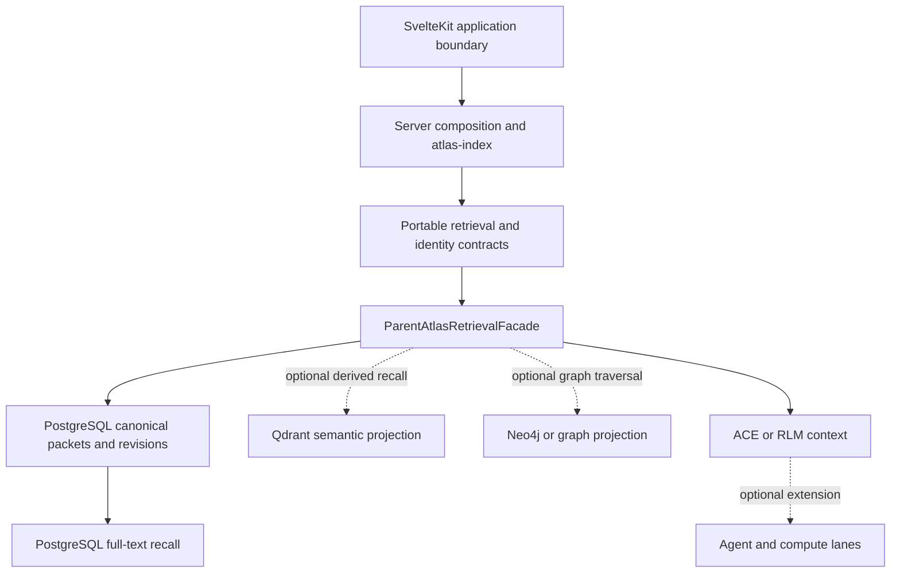

# Parent Atlas Architecture Overview

Parent Atlas is best understood as a **contract-centered retrieval system**, not as a collection of equally authoritative services. The SvelteKit application is the application boundary; portable packages define the vocabulary; the Parent Atlas runtime composes retrieval adapters; PostgreSQL owns canonical packet and revision facts; and vector, graph, cache, and compute surfaces are projections or executors that must resolve back to those facts.

This page uses the following status markers:

- **[proven]** — established by an inspected repository source, schema, or focused test. This does not imply a production deployment.
- **[experimental]** — executable code exists, but the path is incomplete, compatibility-oriented, or not yet a stable authority.
- **[blocked]** — the documented path is explicit, but a required implementation or proof is still absent.
- **[proposed]** — a target boundary or extension point described by architecture documentation rather than demonstrated runtime behavior.
- **[unknown]** — the repository does not establish the fact strongly enough to assert it.

## Smallest useful shape

**[proven]** The active web application lives in `sveltekit-frontend`; the package-boundary specification assigns that application HTTP/UI integration, Drizzle migrations, and server composition, while forbidding it from becoming the canonical graph-authority calculator ([README.md](../../README.md#L1-L3), [PARENT_ATLAS_PACKAGE_BOUNDARIES.md](../../docs/architecture/PARENT_ATLAS_PACKAGE_BOUNDARIES.md#L3-L10)).

**[proven]** The portable layer has two documented responsibilities that should not be conflated. `packages/atlas` owns portable ESM contracts and pure helpers for scripts and application packages, and must not own database clients, service adapters, workers, or migrations ([packages/atlas/README.md](../../packages/atlas/README.md#L1-L16)). `packages/parent-atlas-core` provides the retrieval, policy, identity, context, and provenance contracts; its entrypoint describes it as zero-dependency infrastructure-free code ([packages/parent-atlas-core/src/index.ts](../../packages/parent-atlas-core/src/index.ts#L1-L16)). The core retrieval contract exposes one `search()` operation and one `health()` operation, with use-case policy selecting limits, graph depth, source-reference requirements, and ACE or RLM context ([retrieval.ts](../../packages/parent-atlas-core/src/contracts/retrieval.ts#L14-L19), [retrieval.ts](../../packages/parent-atlas-core/src/contracts/retrieval.ts#L24-L52), [retrieval.ts](../../packages/parent-atlas-core/src/contracts/retrieval.ts#L124-L205)).

**[proposed]** The intended dependency direction is therefore application and protocol composition → portable contracts → runtime implementation → storage and external adapters. The boundary document explicitly makes protocols replaceable adapters and keeps HTTP, gRPC, MCP, and A2A out of core and runtime business logic ([PARENT-ATLAS-SYSTEM-BOUNDARIES.md](../../docs/PARENT-ATLAS-SYSTEM-BOUNDARIES.md#L5-L10), [PARENT-ATLAS-SYSTEM-BOUNDARIES.md](../../docs/PARENT-ATLAS-SYSTEM-BOUNDARIES.md#L30-L89)). That is an architectural rule, not proof that every proposed service or transport is deployed.

*Caption: Source-grounded component and data-flow shape; solid edges describe the core boundary, while dashed edges are optional or incomplete projection and extension lanes.*

The SvelteKit-side `atlas-index` is an integration/export surface, not a second canonical store: it exports runtime context and state helpers, Mastra-facing tools, a Go retrieval client, and other application integrations ([atlas-index.ts](../../sveltekit-frontend/src/lib/server/atlas/atlas-index.ts#L1-L40)). The exports show available composition points; they do not establish that all of those lanes are active in a deployed request path.

## Authority and identity

**[proven]** PostgreSQL is the canonical packet and revision authority. The `atlas_packets` schema makes `packet_id` the primary key and stores `packet_key`, required `source_ref`, source and feature identity, `content_hash`, exact `source_revision`, `workspace_id`, `workspace_revision`, representation revisions, and references to derived stores such as Qdrant, Neo4j, and Redis ([atlas-packets.ts](../../sveltekit-frontend/src/lib/server/db/schema/atlas-packets.ts#L30-L44), [atlas-packets.ts](../../sveltekit-frontend/src/lib/server/db/schema/atlas-packets.ts#L67-L84), [atlas-packets.ts](../../sveltekit-frontend/src/lib/server/db/schema/atlas-packets.ts#L102-L140)). The identity contract states `postgres` as the canonical store and lists Qdrant, Neo4j, Redis, and CouchDB as mirrors ([packages/parent-atlas-core/src/index.ts](../../packages/parent-atlas-core/src/index.ts#L18-L34)).

**[proven]** Source identity and workspace identity are different axes. The schema comments distinguish `source_revision` as the exact source-content revision from `workspace_revision` as an operator-managed workspace revision used in cache qualification; the runtime context likewise treats workspace and packet revisions as caller-owned snapshot or lineage values, not timestamps ([atlas-packets.ts](../../sveltekit-frontend/src/lib/server/db/schema/atlas-packets.ts#L71-L76), [atlas-packets.ts](../../sveltekit-frontend/src/lib/server/db/schema/atlas-packets.ts#L102-L113), [atlas-runtime-context.ts](../../sveltekit-frontend/src/lib/server/atlas/atlas-runtime-context.ts#L20-L31)). A missing revision is observable and remains unqualified: the runtime constructor preserves empty values, and the focused test expects `ATLAS_RUNTIME_REVISION_UNQUALIFIED` rather than a synthesized revision ([atlas-runtime-context.ts](../../sveltekit-frontend/src/lib/server/atlas/atlas-runtime-context.ts#L165-L218), [atlas-runtime-context.spec.ts](../../sveltekit-frontend/src/lib/server/atlas/atlas-runtime-context.spec.ts#L16-L33)).

**[proven]** Canonical identity must survive every retrieval representation. The runtime resolver rejects missing `packet_key`, `source_ref`, or `feature_id`, deduplicates on `(source_ref, feature_id, content_hash)`, and is deliberately placed before reciprocal-rank fusion so one logical packet cannot rank twice ([identity-resolver.ts](../../packages/parent-atlas-runtime/src/adapters/identity-resolver.ts#L1-L20), [identity-resolver.ts](../../packages/parent-atlas-runtime/src/adapters/identity-resolver.ts#L55-L107)). The resolver's separate `validatePacketLineage` database read is still a placeholder returning `true`, so identity shape validation is executable but complete Postgres readback validation is not ([identity-resolver.ts](../../packages/parent-atlas-runtime/src/adapters/identity-resolver.ts#L110-L135)).

## Runtime and adapter control flow

**[proven]** `ParentAtlasRetrievalFacade.search()` selects a policy, performs PostgreSQL lexical recall, merges recall candidates, resolves canonical identity, applies RRF fusion, performs source validation, assembles an ACE or RLM-shaped context, and returns ranked candidates plus a stage trace ([retrieval-facade.ts](../../packages/parent-atlas-runtime/src/facade/retrieval-facade.ts#L52-L68), [retrieval-facade.ts](../../packages/parent-atlas-runtime/src/facade/retrieval-facade.ts#L95-L120), [retrieval-facade.ts](../../packages/parent-atlas-runtime/src/facade/retrieval-facade.ts#L145-L193)). The facade is configured with a Drizzle database and URLs for Qdrant, Neo4j, an embedding service, and an optional cross-encoder, so adapters are injected rather than hard-coded into the application boundary ([retrieval-facade.ts](../../packages/parent-atlas-runtime/src/facade/retrieval-facade.ts#L19-L40)).

**[proven]** The lexical adapter is PostgreSQL native full-text search, not true BM25. The compatibility file named `postgres-bm25.adapter.ts` re-exports the canonical FTS implementation and explicitly records `ts_rank_cd` and the absence of `pg_search`; the canonical SQL searches a GIN-backed `tsvector`, then resolves results to `atlas_packets` using exact `(source_ref, content_hash)` matches or explicitly admitted `EXACT_CANONICAL_ID` chunk links ([postgres-bm25.adapter.ts](../../packages/parent-atlas-runtime/src/adapters/postgres-bm25.adapter.ts#L1-L9), [postgres-fts.adapter.ts](../../packages/parent-atlas-runtime/src/adapters/postgres-fts.adapter.ts#L2-L36), [postgres-fts.adapter.ts](../../packages/parent-atlas-runtime/src/adapters/postgres-fts.adapter.ts#L118-L210)). Its focused tests preserve scorer revision and identity-lane metadata, enforce bounded limits, and reject malformed packet identity ([postgres-fts.adapter.test.ts](../../packages/parent-atlas-runtime/src/adapters/postgres-fts.adapter.test.ts#L15-L71), [postgres-fts.adapter.test.ts](../../packages/parent-atlas-runtime/src/adapters/postgres-fts.adapter.test.ts#L128-L150)).

**[experimental]** A Qdrant adapter exists and enforces a 768-dimensional query vector, calls the `codebase_chunks_768` collection, maps payload identity fields into candidates, and validates point, packet, source, feature, and score fields ([qdrant-recall.adapter.ts](../../packages/parent-atlas-runtime/src/adapters/qdrant-recall.adapter.ts#L1-L23), [qdrant-recall.adapter.ts](../../packages/parent-atlas-runtime/src/adapters/qdrant-recall.adapter.ts#L31-L83), [qdrant-recall.adapter.ts](../../packages/parent-atlas-runtime/src/adapters/qdrant-recall.adapter.ts#L85-L125)). This is adapter capability, not proof of live semantic retrieval: the current facade leaves `qdrantCandidates` as an empty array and marks query embedding plus Qdrant search as TODO ([retrieval-facade.ts](../../packages/parent-atlas-runtime/src/facade/retrieval-facade.ts#L85-L93)).

**[blocked]** The current facade is not a complete nine-stage production retrieval pipeline. Identity resolution and RRF are executable, but Neo4j graph expansion, XGBoost feature extraction, CrossEncoder reranking, and the deeper context-assembly pipeline are explicitly placeholders; the facade currently truncates candidates and filters source references rather than running those missing stages ([retrieval-facade.ts](../../packages/parent-atlas-runtime/src/facade/retrieval-facade.ts#L122-L166)). Its `health()` method returns `true` without probing Postgres, Qdrant, or Neo4j, and the final mapping still labels `retrievedVia` as `bm25` with a TODO to track the actual stage ([retrieval-facade.ts](../../packages/parent-atlas-runtime/src/facade/retrieval-facade.ts#L168-L211)). Do not use package exports or an architecture README as evidence of a live end-to-end deployment.

## Rebuildable projections and optional lanes

**[proven]** Qdrant is a rebuildable semantic retrieval projection whose points must resolve through canonical packet identity; Neo4j and NetworkX or cuGraph are derived graph projections and traversal executors; Valkey or Redis is a bounded, expiring, revision-qualified cache; and optional CUDA, cuVS, TensorRT, and PyTorch surfaces are executors over frozen inputs rather than authorities ([atlas-store-ownership-and-derived-representations-v1.md](../../docs/architecture/atlas-store-ownership-and-derived-representations-v1.md#L5-L16)). This makes a projection loss or stale cache an operational recovery problem, not a reason to promote that projection to identity authority.

**[proposed]** Rebuilds should begin from qualified PostgreSQL packet, source, and workspace facts, then materialize derived vector, graph, feature, or cache views with their identity and revision metadata. The store-ownership guidance requires stable identities and revision-qualified descriptors for maps and feature matrices, while the packet schema records representation revisions and embedding lineage needed to reject incompatible reuse ([atlas-store-ownership-and-derived-representations-v1.md](../../docs/architecture/atlas-store-ownership-and-derived-representations-v1.md#L18-L25), [atlas-packets.ts](../../sveltekit-frontend/src/lib/server/db/schema/atlas-packets.ts#L111-L130)). The repository establishes the ownership rule; it does not, in the inspected facade, establish a single automatic rebuild coordinator.

**[experimental]** Agent and orchestration lanes are application extensions around the same runtime context. `atlas-index` exports Mastra tools, request-context construction, delegation, and Go retrieval helpers, while `AtlasRuntimeContext` carries workspace and packet revisions, mutation authorization, token budgets, state, and receipt-derived observations ([atlas-index.ts](../../sveltekit-frontend/src/lib/server/atlas/atlas-index.ts#L17-L35), [atlas-runtime-context.ts](../../sveltekit-frontend/src/lib/server/atlas/atlas-runtime-context.ts#L8-L18), [atlas-runtime-context.ts](../../sveltekit-frontend/src/lib/server/atlas/atlas-runtime-context.ts#L20-L51)). Runtime receipts are strict, identity-bearing evidence; missing or mismatched receipts fail closed rather than creating a successful observation ([atlas-runtime-context.ts](../../sveltekit-frontend/src/lib/server/atlas/atlas-runtime-context.ts#L76-L162)). These exports and contracts show an extension boundary, not an assertion that a particular agent, model, GPU, or Go service is active in production.

**[proposed]** Protocol adapters, agent tools, and compute executors should remain replaceable callers of the canonical retrieval contract. They may add transport, bounded tool policy, acceleration, or synthesis, but they must not mint packet identity, admit evidence, or become a second source/workspace authority. The documented protocol boundary places transport handling in clients and service composition and forbids protocol logic in core and runtime ([PARENT-ATLAS-SYSTEM-BOUNDARIES.md](../../docs/PARENT-ATLAS-SYSTEM-BOUNDARIES.md#L92-L117), [PARENT-ATLAS-SYSTEM-BOUNDARIES.md](../../docs/PARENT-ATLAS-SYSTEM-BOUNDARIES.md#L150-L174)).

## Lifecycle, failures, and safe change points

**[proven]** A retrieval request is policy-qualified and should preserve lineage from recall through context. The hard safety points are: require packet identity fields; resolve duplicates before fusion; require `source_ref` when the selected policy says so; keep workspace and packet revisions explicit; and treat projection output as resolvable evidence rather than canonical truth ([retrieval.ts](../../packages/parent-atlas-core/src/contracts/retrieval.ts#L143-L205), [identity-resolver.ts](../../packages/parent-atlas-runtime/src/adapters/identity-resolver.ts#L64-L107), [atlas-runtime-context.ts](../../sveltekit-frontend/src/lib/server/atlas/atlas-runtime-context.ts#L165-L175)).

**[experimental]** Failure behavior is mixed and must be read from the implementation, not inferred from the target diagram. The FTS adapter returns no database call for a blank query and validates result shape; the Qdrant adapter throws on invalid dimensions or HTTP failure; the facade wraps downstream errors as `Retrieval failed: ...` ([postgres-fts.adapter.ts](../../packages/parent-atlas-runtime/src/adapters/postgres-fts.adapter.ts#L93-L116), [qdrant-recall.adapter.ts](../../packages/parent-atlas-runtime/src/adapters/qdrant-recall.adapter.ts#L35-L81), [retrieval-facade.ts](../../packages/parent-atlas-runtime/src/facade/retrieval-facade.ts#L195-L200)). The current implementation does not yet demonstrate a general graceful-degradation policy for unavailable Qdrant or graph services because those lanes are not wired through the facade.

**[proven]** Focused tests that matter for changes to this shape are the revision-boundary tests in `atlas-runtime-context.spec.ts`, the PostgreSQL FTS metadata, identity, limit, and validation tests in `postgres-fts.adapter.test.ts`, and the runtime source files that enforce identity-before-RRF and revision qualification. Changes to packet identity, source joins, workspace or representation revisions, or adapter wiring should update these tests before any projection or agent lane is promoted.

## Related pages

- [Boundaries and Authority](boundaries-and-authority.md)
- [System Map](system-map.md)
- [Packet Identity and Provenance](../concepts/packet-identity-and-provenance.md)
- [Protocol and Service Adapters](../integrations/protocol-and-service-adapters.md)
