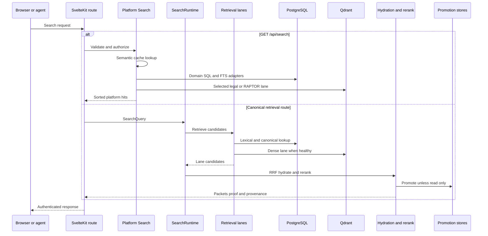

# System Map and Runtime Domains

## Reading this map

This page distinguishes **callable code paths** from **architecture or service intent**. The repository currently contains two different SvelteKit-facing search shapes, a package-level Parent Atlas facade, and several optional compute or transport lanes. They share identity rules, but they are not one flattened runtime:

- **Canonical application retrieval:** `SearchRuntime.search()` owns the SvelteKit codebase retrieval path. Its production factory retrieves candidates, fuses them, hydrates canonical packets, applies policy-driven reranking, and may promote results.
- **Platform Search:** `GET /api/search` is a separate authenticated platform endpoint. It fans out to domain adapters, optionally tries a Go search service, sorts `PlatformSearchHit` values, and returns grouped adapter timings. It does **not** call `SearchRuntime`.
- **Parent Atlas package facade:** `ParentAtlasRetrievalFacade` is an infrastructure-backed implementation of the `@deeds/parent-atlas-core` contract. Its Qdrant, graph, reranking, and health stages are partly placeholders even though the stage trace records them.
- **Optional lanes:** Go clients, Mastra tools, MCP, A2A, TurboVec, Valkey or Redis, Qdrant, Neo4j, DuckDB, and model services are adapters or projections. They do not replace canonical packet identity.

The governing data rule is that PostgreSQL `atlas_packets` and source/workspace records own packet identity and status. Qdrant points, graph nodes, Valkey or Redis entries, RPC responses, and agent contexts are projections or adapters that preserve that identity. The core contract declares `canonical_store: 'postgres'` and mirrors for `qdrant`, `neo4j`, `redis`, and `couchdb` ([identity contract](../../packages/parent-atlas-core/src/index.ts#L18-L34)). The locked architecture contract makes identity fields read-only after creation and puts enrichment in metadata subtrees ([identity immutability](../../docs/CANONICAL-ARCHITECTURE-CONTRACT.md#L9-L80)).

## Request paths at a glance

*Caption: The separate Platform Search fan-out and the canonical SearchRuntime request path, including their inspected fallbacks and read-only promotion boundary.*

## Application entrypoints and ownership

### SvelteKit server boundary

`src/lib/server/atlas/atlas-index.ts` is a unified server-side export boundary. It exposes runtime context and FSM policy, registry recommendations, Mastra tool adapters, Go retrieval functions (`retrieveFromGo`, `buildContextFromGo`, and `validatePacketFromGo`), packet processing and consumer functions, ranking feature construction, phase-lane proofs, and Kanban task operations ([Atlas index](../../sveltekit-frontend/src/lib/server/atlas/atlas-index.ts#L1-L76), [task and analysis exports](../../sveltekit-frontend/src/lib/server/atlas/atlas-index.ts#L86-L126)). This is an application orchestration surface, not the packet store and not an alternate identity authority.

The root server layout is concerned with authentication-aware SSR caching rather than retrieval. Authenticated requests receive `private, no-cache, no-store, must-revalidate`; public requests receive ten-minute browser caching and one-hour shared caching ([layout cache policy](../../sveltekit-frontend/src/routes/+layout.server.ts#L3-L28)). Route handlers still perform their own authorization checks.

Atlas packet consumption is a downstream evidence and tool-assembly lane. `runPacketConsumerPipeline` ranks input packets, builds a feature matrix, selects within token and packet limits, assembles a manifest, validates a tool decision, executes MCP, records a tool receipt, and then synthesizes from that receipt ([packet consumer pipeline](../../sveltekit-frontend/src/lib/server/atlas/packet-consumer-pipeline.ts#L90-L142)). This consumes selected packet evidence; it does not create canonical packet identity.

### Canonical SvelteKit retrieval: `SearchRuntime`

`SearchRuntime` is the implemented SvelteKit retrieval orchestrator. Its `search()` method validates a bounded `SearchQuery`, checks embedding-service health, retrieves candidates, performs RRF fusion, hydrates canonical feature envelopes with proof, selects a policy and execution budget for reranking, and returns packets with metadata, proof, provenance, and stage timings ([search entrypoint](../../sveltekit-frontend/src/lib/server/retrieval/search-runtime.ts#L478-L658), [rerank and provenance](../../sveltekit-frontend/src/lib/server/retrieval/search-runtime.ts#L1025-L1157)). Its production factory has no injected adapters; tests and controlled callers can inject retrievers or a reranker ([factory](../../sveltekit-frontend/src/lib/server/retrieval/search-runtime.ts#L1580-L1604)).

The retrieval stage is bounded and fail-open at adapter boundaries:

1. With no injected retrievers, `retrieveCandidates` calls `retrieveAllCandidates`; with injected retrievers it calls each lane in parallel, converts lane results to the common `Candidate` shape, and turns an individual lane error into an empty result. Metadata filters are applied after projection ([candidate retrieval](../../sveltekit-frontend/src/lib/server/retrieval/search-runtime.ts#L880-L995)).
2. The runtime fuses candidates through one RRF implementation, then hydrates from PostgreSQL-backed packet data. Identity and revision proof fields are carried in the result rather than guessed from a vector hit ([fusion and hydration](../../sveltekit-frontend/src/lib/server/retrieval/search-runtime.ts#L997-L1023)).
3. Reranking routes policy state and execution budget into the canonical reranker. If the reranker returns no results for non-empty input, the runtime preserves the retrieved envelopes in order. Promotion and policy-training writes are skipped in `readOnly` mode ([rerank fallback and writes](../../sveltekit-frontend/src/lib/server/retrieval/search-runtime.ts#L1095-L1157)).

Embedding and Qdrant behavior needs operational care. Embedding health is cached for 60 seconds and checked with a 1.5-second timeout; an unhealthy service disables vector lanes for that request, allowing lexical and other candidates to continue ([embedding health](../../sveltekit-frontend/src/lib/server/retrieval/search-runtime.ts#L29-L61), [health-aware retrieval](../../sveltekit-frontend/src/lib/server/retrieval/search-runtime.ts#L520-L536)). `initializeSearchRuntime()` is an explicit, once-only boot hook for non-fatal Qdrant collection and named-vector dimension validation; importing the module remains side-effect free ([Qdrant validation](../../sveltekit-frontend/src/lib/server/retrieval/search-runtime.ts#L63-L174)). A missing collection or wrong dimension produces warnings and requires reconciliation or re-projection before dense scores are trusted.

The canonical route callers are `/api/search/hyperrag` and the legacy-compatible `/api/rag/hyperrag`. The former creates `SearchRuntime`, passes workspace and representation revisions, and can add a verified function-registry retriever and bounded hypergraph fusion ([HyperRAG route](../../sveltekit-frontend/src/routes/api/search/hyperrag/+server.ts#L83-L171)). The latter explicitly documents itself as a compatibility wrapper while delegating retrieval to the same runtime ([legacy wrapper](../../sveltekit-frontend/src/routes/api/rag/hyperrag/+server.ts#L7-L18), [runtime call](../../sveltekit-frontend/src/routes/api/rag/hyperrag/+server.ts#L74-L103)). The route test verifies that an authenticated request is converted to a canonical compatibility packet and that unauthenticated callers are rejected ([route test](../../sveltekit-frontend/src/routes/api/rag/hyperrag/server.route.test.ts#L21-L90)).

### Separate Platform Search route: `GET /api/search`

`/api/search` is a platform-wide search endpoint, not an alias for `SearchRuntime`. It validates a shorter `q` contract and platform domain type, requires `locals.user.id`, checks the semantic cache first, then builds domain adapters for cases, evidence, POI, citations, legal, glossary, reports, messages, and canon. The operator router may add RAPTOR or agentic research lanes ([Platform Search handler](../../sveltekit-frontend/src/routes/api/search/+server.ts#L40-L67), [authorization and cache](../../sveltekit-frontend/src/routes/api/search/+server.ts#L553-L600), [adapter selection](../../sveltekit-frontend/src/routes/api/search/+server.ts#L605-L647)).

Its legal adapter tries Go gRPC first, then Go HTTP, then inline PostgreSQL SQL. A failed gRPC client enters a 30-second retry cooldown; a failed adapter is recorded as an error and returns an empty hit list. All selected adapters run under `Promise.allSettled`, hits are sorted by score, cache writes are non-blocking, and ETags plus cache-control headers are returned ([Go and SQL fallback](../../sveltekit-frontend/src/routes/api/search/+server.ts#L112-L226), [fan-out and response](../../sveltekit-frontend/src/routes/api/search/+server.ts#L651-L713)). This route returns `PlatformSearchHit[]` grouped by domain and timing, whereas `SearchRuntime` returns packet envelopes with retrieval proof and provenance.

## Parent Atlas package layers

### Core contract and identity

`@deeds/parent-atlas-core` defines the transport-neutral retrieval facade and request/result types, policy registry, ranked candidates, context types, provenance, and identity-chain verification ([core exports](../../packages/parent-atlas-core/src/index.ts#L14-L34), [lineage verification](../../packages/parent-atlas-core/src/index.ts#L46-L79)). The identity chain includes directory, source, file, symbol, feature, and `packet_key`; missing fields fail verification. Core is a boundary package rather than the owner of a database or SvelteKit request lifecycle. Its package metadata declares `zod` and `drizzle-orm`, so “dependency-light” is more accurate than “no declared dependencies” ([core package metadata](../../packages/parent-atlas-core/package.json#L30-L41)).

### Infrastructure-backed runtime facade

`@deeds/parent-atlas-runtime` owns adapter functions and `ParentAtlasRetrievalFacade`, the package implementation of the core contract. The facade selects a use-case policy, recalls from PostgreSQL, prepares a Qdrant lane, resolves canonical identity **before** RRF, applies bounded graph and reranking limits, validates source references, assembles ACE or RLM context, and returns stage timings and candidate counts ([runtime exports](../../packages/parent-atlas-runtime/src/index.ts#L14-L44), [facade stages](../../packages/parent-atlas-runtime/src/facade/retrieval-facade.ts#L52-L193)). Do not equate this facade with SvelteKit `SearchRuntime`: they are separate implementations with different result contracts and implementation coverage.

The first live lexical adapter is PostgreSQL native full-text search, not true BM25. `searchPostgresFts` queries the GIN-backed `codebase_chunk_index.search_vector` with `websearch_to_tsquery` and `ts_rank_cd`, joins canonical packets by exact `(source_ref, content_hash)`, and admits a second bridge only for `EXACT_CANONICAL_ID` links ([FTS adapter](../../packages/parent-atlas-runtime/src/adapters/postgres-fts.adapter.ts#L4-L17), [query and joins](../../packages/parent-atlas-runtime/src/adapters/postgres-fts.adapter.ts#L87-L209)). The old `postgres-bm25.adapter.ts` is only a deprecated compatibility re-export ([compatibility adapter](../../packages/parent-atlas-runtime/src/adapters/postgres-bm25.adapter.ts#L1-L9)). Unresolved and ambiguous bridge rows are structurally excluded; a chunk cannot invent a packet key.

The package facade records nine stages, but several are explicitly placeholders: query embedding and Qdrant search currently produce an empty Qdrant lane, Neo4j k-hop expansion is a TODO, XGBoost and optional CrossEncoder reranking are TODOs, and `health()` returns `true` while backing-service probes remain TODOs ([placeholder recall](../../packages/parent-atlas-runtime/src/facade/retrieval-facade.ts#L85-L93), [placeholder graph and rerank](../../packages/parent-atlas-runtime/src/facade/retrieval-facade.ts#L122-L143), [health placeholder](../../packages/parent-atlas-runtime/src/facade/retrieval-facade.ts#L202-L211)). These stages are trace-visible scaffolding, not evidence that those services are active on this path.

### Client and protocol adapters

`@deeds/parent-atlas-client` packages HTTP/REST, gRPC, MCP, and A2A clients plus transport errors, and re-exports core contracts ([client exports](../../packages/parent-atlas-client/src/index.ts#L1-L49)). The client layer owns serialization, protocol lifecycle, timeout and transport-error behavior; it must not own packet deduplication, ranking, graph traversal, or packet writes. The boundary document marks full gRPC service and target standalone service routes as design intent, so select a concrete client implementation rather than inferring availability from package metadata ([protocol boundary](../../docs/PARENT-ATLAS-SYSTEM-BOUNDARIES.md#L92-L117), [planned service](../../docs/PARENT-ATLAS-SYSTEM-BOUNDARIES.md#L150-L173)). The focused gRPC client tests cover request mapping, streaming, degraded health, and close semantics ([client tests](../../packages/parent-atlas-client/test/grpc-client.test.mjs#L33-L80)).

### Orchestration and agent adapters

`@deeds/atlas-orchestrator` packages Mastra and LangGraph workflows, checkpointing, PostgreSQL and Redis stores, LangSmith, model dependencies, executors, and prompt-plan exports. Its scripts separate build, test, lint, type-check, development, and runtime-import smoke checks ([orchestrator metadata](../../packages/atlas-orchestrator/package.json#L1-L25), [orchestrator dependencies](../../packages/atlas-orchestrator/package.json#L27-L54)). It is an optional durable-compute and planning domain for PageRank, clustering, registry alignment, labeling, and agent workflows; PostgreSQL packet identity remains governed by the core contract, not by orchestration state.

Mastra tools and the Go retrieval client exported by `atlas-index.ts` are adapters around retrieval, validation, context, delegation, and runtime inspection. MCP is a tool protocol and A2A is asynchronous task delegation; neither changes canonical packet ownership. The boundary rules keep protocol handling in clients and prevent clients from importing runtime business logic ([one-way boundary and protocol rules](../../docs/PARENT-ATLAS-SYSTEM-BOUNDARIES.md#L314-L339)).

## Ingestion, storage, and projections

`@deeds/parent-atlas-ingest` describes the ingestion layers as directory scanning, language parsing, feature classification, packet generation, and store adapters ([ingest package](../../packages/parent-atlas-ingest/src/index.ts#L1-L13)). The safe lifecycle is: scan and classify source material, create or reconcile canonical PostgreSQL packet, source, and workspace records, then project searchable or contextual forms. Enrichment belongs in topology, ranking, graph, or memory metadata and must not change `packet_key`, `source_ref`, `feature_id`, `feature_label`, or identity provenance ([canonical enrichment rules](../../docs/CANONICAL-ARCHITECTURE-CONTRACT.md#L30-L80)).

The SvelteKit `packet-pipeline.ts` is a compute bridge, not a packet authority. It lazily loads the Rust N-API TurboVec binding and falls back to JavaScript when the addon is absent. Native and fallback operations include source-reference hashing, edge deduplication, SOM scoring, JSONL loading, and Qdrant payload packing ([bridge responsibilities and lazy fallback](../../sveltekit-frontend/src/lib/server/packet-pipeline.ts#L4-L67), [hash, edge, and SOM fallbacks](../../sveltekit-frontend/src/lib/server/packet-pipeline.ts#L70-L149), [payload packing](../../sveltekit-frontend/src/lib/server/packet-pipeline.ts#L168-L254)). Valkey or Redis remains a hot semantic-cache lane, Qdrant an ANN and payload-filter lane, Neo4j a contextual graph lane, PyTorch an optional compression process, LangGraph orchestration, BitFrost routing or cache gateway, and DuckDB or CouchDB offline or archive surfaces. None is allowed to mint a competing canonical packet identity.

PostgreSQL retrieval is deliberately fail-closed about identity. The exact source and content-hash join is preferred; the bridge joins only admitted `EXACT_CANONICAL_ID` rows, rejects ambiguous or unresolved links, and requires a unique packet match before returning a candidate ([identity-link guard](../../packages/parent-atlas-runtime/src/adapters/postgres-fts.adapter.ts#L140-L209)). The focused adapter tests exercise empty-query behavior, scorer metadata, both identity lanes, bounded limits, fallback identity labeling, and result validation ([FTS tests](../../packages/parent-atlas-runtime/src/adapters/postgres-fts.adapter.test.ts#L15-L71), [validation tests](../../packages/parent-atlas-runtime/src/adapters/postgres-fts.adapter.test.ts#L128-L150)).

## Invariants and failure semantics

1. **Canonical ownership:** PostgreSQL packet, source, and workspace state is authoritative. Projections are rebuildable; enrichment is metadata-only.
2. **Identity before fusion:** recall lanes must resolve or validate canonical identity before RRF, otherwise the same packet can receive multiple rank votes ([ordering rule](../../docs/PARENT-ATLAS-SYSTEM-BOUNDARIES.md#L284-L299)).
3. **Boundedness:** limits and source scopes apply at recall; `SearchQuery.topK` and package-facade policy limits bound downstream work. Graph expansion is optional and bounded, not an unbounded traversal.
4. **Graceful degradation by boundary:** SearchRuntime retrievers convert lane errors to empty candidates and preserve retrieval order when reranking returns no output. Platform Search isolates adapter failures with `timedAdapter` and `Promise.allSettled`. The package facade records an empty Qdrant lane and skips TODO graph work. Transport retry or escalation belongs to client adapters; domain tool failures remain visible to agents ([fallback policy](../../docs/PARENT-ATLAS-SYSTEM-BOUNDARIES.md#L301-L310)).
5. **Read-only safety:** `SearchRuntime` still retrieves, fuses, hydrates, and reranks in `readOnly` mode, but suppresses promotion and training writes. The focused runtime test proves two-lane shadow execution, disabled cache and shadow receipts, and no promotion writes ([read-only test](../../sveltekit-frontend/src/lib/server/retrieval/search-runtime.spec.ts#L501-L643)).
6. **Observability:** both retrieval implementations expose stage timing or candidate counts. SearchRuntime additionally returns identity, hydration, revision, rerank, and provenance proof; the package facade returns a stage trace ([SearchRuntime trace](../../sveltekit-frontend/src/lib/server/retrieval/search-runtime.ts#L538-L581), [package trace](../../packages/parent-atlas-runtime/src/facade/retrieval-facade.ts#L168-L193)).

## Focused change and verification guide

When changing this map’s domains, verify the boundary that owns the behavior rather than a similarly named adapter:

| Change question | Inspect first | Focused verification |
| --- | --- | --- |
| Does a search caller use the canonical runtime? | [`/api/search/hyperrag`](../../sveltekit-frontend/src/routes/api/search/hyperrag/+server.ts#L121-L143) or [`/api/rag/hyperrag`](../../sveltekit-frontend/src/routes/api/rag/hyperrag/+server.ts#L74-L103) | [`search-runtime.spec.ts`](../../sveltekit-frontend/src/lib/server/retrieval/search-runtime.spec.ts#L100-L250) and [`server.route.test.ts`](../../sveltekit-frontend/src/routes/api/rag/hyperrag/server.route.test.ts#L57-L90) |
| Is the call the separate Platform Search route? | [`/api/search`](../../sveltekit-frontend/src/routes/api/search/+server.ts#L555-L713) | Exercise authentication, cache, adapter timing, and ETag behavior at the route boundary |
| Can a chunk be admitted as a packet? | [`postgres-fts.adapter.ts`](../../packages/parent-atlas-runtime/src/adapters/postgres-fts.adapter.ts#L140-L209) | [`postgres-fts.adapter.test.ts`](../../packages/parent-atlas-runtime/src/adapters/postgres-fts.adapter.test.ts#L34-L64) |
| Is a transport or service optional? | [`parent-atlas-client`](../../packages/parent-atlas-client/src/index.ts#L18-L45) and [`packet-pipeline.ts`](../../sveltekit-frontend/src/lib/server/packet-pipeline.ts#L36-L67) | [`grpc-client.test.mjs`](../../packages/parent-atlas-client/test/grpc-client.test.mjs#L47-L80) and the runtime fallback tests above |
| Could the change write or rename identity? | [`IDENTITY_CONTRACT`](../../packages/parent-atlas-core/src/index.ts#L18-L34) and the canonical contract | Verify packet identity and lineage before rebuilding projections |

For authority ownership and boundary decisions, see [Boundaries and Authority](boundaries-and-authority.md). For concrete transport adapters, see [Protocol and Service Adapters](../integrations/protocol-and-service-adapters.md). The formerly linked Retrieval Request workflow is not present in this repository, so this page intentionally points to the inspected route callers and focused runtime test instead of retaining a broken wiki link.
