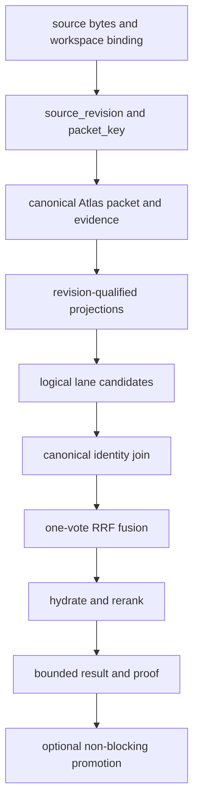

# Parent Atlas Glossary

This glossary uses the repository's live contracts rather than older architectural slogans. Status labels describe the strength or scope of the current evidence:

- **[proven]** — defined by a current contract and supported by an implementation or focused tests.
- **[experimental]** — an implemented challenger, optional path, or narrowly integrated projection; do not treat it as canonical by default.
- **[blocked]** — a contract or control exists, but an admission, parity, population, or promotion gate is not satisfied.
- **[proposed]** — design or requirement language without sufficient live implementation evidence.
- **[unknown]** — conflicting, legacy, or unverified terminology; preserve the conflict instead of choosing a meaning by implication.

## Authority, packets, and revisions

### Packet — [proven]

A **packet** is the file-granularity canonical record addressed by `packet_key`. The live authority is PostgreSQL `atlas_packets`; embeddings, Qdrant points, graph nodes, caches, rankings, and summaries are enrichment or projections attached to that record. The table contains both identity anchors (`packet_key`, `source_ref`, `feature_id`) and revision/representation metadata, but the presence of a derived value does not make it identity. See [packet identity and provenance](./packet-identity-and-provenance.md) and the [live packet schema](../../sveltekit-frontend/src/lib/server/db/schema/atlas-packets.ts#L30-L44).

Older documents sometimes use “packet” for a chunk, vector point, or transport envelope. That is **[unknown]** as a canonical identity rule: a file packet and a chunk have separate lineage, and a Qdrant point is not a packet key.

### `source_ref` / `sourceRef` — [proven]

The canonical source location for a packet or observation. The source-binding contract requires a non-empty, repository-relative, traversal-free physical path; import aliases, absolute paths, backslashes, and `..` traversal are rejected. The value is already canonical and case-sensitive: `packet-key-v2.ts` validates it but does not normalize it. See the [workspace source-binding contract](../../sveltekit-frontend/src/lib/server/atlas/identity/workspace-source-binding-v1.ts#L7-L16) and [packet-key source checks](../../sveltekit-frontend/src/lib/server/atlas/identity/packet-key-v2.ts#L52-L64).

Do not silently substitute `file_path`, a Git URL, an LSP URI, a Qdrant point ID, or a local import alias for `source_ref`. Those can be provenance or projection fields, but are not equivalent identity fields.

### `packet_key` — [proven]

Immutable logical packet identity. Packet Key V2 computes `packet:<UUIDv5>` from exactly `repositoryScope`, canonical `sourceRef`, and `packetKind` (`SOURCE_FILE` is the currently defined kind). `source_revision`, `workspace_revision`, Qdrant IDs, graph-node keys, ordinals, and `latest`/`current` are forbidden inputs; a revision qualifies a key but never changes it. Legacy packet keys are compatibility aliases, not a second canonical scheme. See [PacketKeyV2](../../sveltekit-frontend/src/lib/server/atlas/identity/packet-key-v2.ts#L2-L21) and its [computation](../../sveltekit-frontend/src/lib/server/atlas/identity/packet-key-v2.ts#L66-L94).

`packet_key` is not `title_id`. The title registry permits a title backfill to update only `title_id`, its generator version, and `updated_at`; `packet_key`, `source_ref`, `feature_id`, `tree_node_id`, and `qdrant_point_id` are read-only identity columns ([registry constants](../../packages/atlas/lib/packet-registry.mjs#L14-L39)).

### `source_revision` — [proven]

The exact source-content revision, normally `sha256:<64 hex characters>`. A source binding requires `sourceRevision === sha256:${contentDigest}`. It qualifies packet content and allows stale derived artifacts to be rejected; it is not a replacement for `packet_key` or `workspace_revision` ([source binding](../../sveltekit-frontend/src/lib/server/atlas/identity/workspace-source-binding-v1.ts#L26-L37)).

### `workspace` and `workspace_revision` — [proven]

A **workspace** is the revision-qualified source set being processed, not merely a directory name or current Git `HEAD`. The workspace revision is a digest of the sorted source manifest, including source references, content revisions/digests, byte lengths, and available blob provenance. Dirty and untracked files therefore affect the revision. The record is explicitly a read-only observation and not itself canonical authority ([workspace revision construction](../../sveltekit-frontend/src/lib/server/atlas/identity/workspace-source-binding-v1.ts#L40-L68), [manifest digest](../../sveltekit-frontend/src/lib/server/atlas/identity/workspace-source-binding-v1.ts#L121-L177)).

A workspace event stream separately tracks ordered workspace changes. `appendWorkspaceEventV1` rejects workspace, base-snapshot, sequence, previous-head, event-checksum, and derived-head-revision conflicts; invalidations are emitted with `writesPerformed: false` ([workspace event/head contract](../../sveltekit-frontend/src/lib/server/atlas/workspace/workspace-event-sourcing-v1.ts#L56-L118), [append and invalidation rules](../../sveltekit-frontend/src/lib/server/atlas/workspace/workspace-event-sourcing-v1.ts#L129-L229)).

**Legacy field warning:** the Drizzle `atlas_packets.workspace_revision` column is currently an integer counter with default `0`, while the workspace-source and search contracts use a string digest revision. Do not coerce those owners into one type or assume equal semantics. The packet schema also has `representation_revision` as an integer contract version. See [packet columns and comments](../../sveltekit-frontend/src/lib/server/db/schema/atlas-packets.ts#L102-L126).

### Revision axes

Keep these axes separate:

| Axis | Meaning | Typical failure when absent or mismatched |
|---|---|---|
| `source_revision` | exact bytes for one `source_ref` | source or content evidence is unproven |
| `workspace_revision` | exact manifest/source set being processed | workspace-scoped cache or execution is stale |
| `repository_revision` | repository/compiler lineage, not a content digest | repository provenance cannot be joined |
| `graph_revision` | immutable structural/relationship snapshot | graph edge or rank cannot be admitted |
| `representation_revision` | representation contract/model version | a vector or projection may belong to the wrong space |
| `packet_revision` | packet-qualified revision identity, when used | replay cannot distinguish content state |

Equal text, a matching path, or equal vector dimensions does not prove that two revision axes match.

## Representations, evidence, and projections

### Representation — [proven]

A **representation** is a versioned materialization attached to an already-resolved identity. It is not an identity generator. The current semantic family is `semantic_768` from EmbeddingGemma; `semantic_mrl_512`, `semantic_mrl_256`, and `semantic_mrl_128` are derived prefix-plus-renormalization views. The learned `latent_256` family and its `latent_128`/`latent_64` prefixes are a different coordinate space from semantic MRL, even when dimensions match. See the [current representation contract](../../docs/architecture/parent-atlas-representation-structural-contract.md#L29-L67) and [learned-family distinction](../../docs/architecture/parent-atlas-representation-structural-contract.md#L104-L142).

The canonical physical semantic store is PostgreSQL; Qdrant's `codebase_chunks_768` named `content` vector is a rebuildable projection. The separate `signature` vector is structural/signature retrieval, not semantic content ranking. Legacy 384-dimensional values are compatibility or routing material unless a separate producer and revision proof exists ([retrieval dense contract](../../openspec/specs/atlas-retrieval-reconciliation/spec.md#L96-L119)).

### Evidence — [proven]

**Evidence** is a revision-qualified observation or relation that supports, blocks, specifies, implements, tests, or validates a feature or decision. The feature evidence contract is many-to-many: one feature can have many requirements, artifacts, routes, tables, symbols, package capabilities, tests, and runtime observations, and one evidence item can support multiple features. Edges carry a relation type, source reference/revision, producer lineage, evidence references, and confidence ([typed evidence requirements](../../openspec/specs/atlas-feature-evidence-graph/spec.md#L9-L37), [relationship contract](../../openspec/specs/atlas-feature-evidence-graph/spec.md#L118-L166)).

Evidence confidence is confidence in interpreting the evidence, not feature completion. Completion is the satisfied acceptance criteria on a 0–100 scale; confidence is how likely that computed state reflects current reality. Similarity, PageRank, clusters, model confidence, or document claims cannot independently mark a feature `VERIFIED` ([feature-state requirements](../../openspec/specs/atlas-feature-state/spec.md#L9-L23)).

### N-ary evidence / hyperedge — [proven]

When one fact genuinely involves three or more entity types, preserve it as one typed relation or hyperedge with roles and participants. Pairwise Neo4j/NetworkX/cuGraph edges may be traversal projections, but must retain the canonical relationship ID so the original fact can be reconstructed. `relationship_degree` counts distinct entity types; it is not graph degree, participant count, PageRank, or edge count ([n-ary relation rules](../../openspec/specs/atlas-feature-evidence-graph/spec.md#L41-L114)).

### Projection — [proven]

A **projection** is a rebuildable or operational view of canonical Atlas identity/evidence. Qdrant projects vectors, Neo4j/NetworkX/cuGraph project graph traversal structures or execute algorithms, and Valkey/BitFrost can provide revision-qualified hot caches. Projections must preserve their source identity, revision, model/representation, graph/projection revision, and checksum sufficiently to join back to PostgreSQL. They may accelerate retrieval; they may not mint identity or become a second evidence authority ([storage ownership](../../docs/architecture/parent-atlas-representation-structural-contract.md#L369-L391), [projection parity](../../openspec/specs/atlas-feature-evidence-graph/spec.md#L158-L174)).

### Receipt — [proven]

A **receipt** is a tamper-evident, revision-qualified record of an observation, binding, execution stage, selection, admission decision, or state computation. It is not a second authority. A feature-state receipt includes `feature_id`, feature and evidence-snapshot revisions, completion, confidence, state, blocking/satisfied evidence, priority signals, and producer revision ([state receipt](../../openspec/specs/atlas-feature-state/spec.md#L66-L85)). Graphify stage receipts bind input/output checksums and optional receipt references ([stage receipt contract](../../sveltekit-frontend/src/lib/server/atlas/indexing/graphify-daily-coordinator-v1.ts#L410-L415)).

Missing proof must be represented as `MISSING_BINDING`, `UNPROVEN`, a stale state, or a named admission failure; a receipt must not fabricate a digest, score, identity, or zero value.

## Retrieval vocabulary

### Logical retrieval lane — [proven invariant; experimental coverage varies]

A **logical lane** is a semantic source of retrieval evidence, not a physical executor. The OpenSpec reconciliation contract recommends lexical, structural/AST, semantic, graph, and association/low-rank lanes; multiple executors for one lane receive one fusion vote. Candidates must be resolved to canonical identity before cross-lane fusion, and degraded identity remains observable ([lane and identity requirements](../../openspec/specs/atlas-retrieval-reconciliation/spec.md#L9-L15), [promotion and fan-out rules](../../openspec/specs/atlas-retrieval-reconciliation/spec.md#L63-L84)).

The live SearchRuntime executes a bounded type-level set (`dense`, `lexical`, `exact`, `ast`, `schema`, `rg`, `bm42`) and records executor IDs separately from lane evidence; its `LaneEvidence` explicitly says all executors still count as one lane vote ([runtime lane model](../../sveltekit-frontend/src/lib/server/retrieval/search-runtime.ts#L267-L289)). The contract's graph and low-rank recommendations therefore describe broader reconciliation scope than the current union; do not silently add a graph vote merely because a graph executor exists.

**Lexical conflict:** current production lexical ownership is PostgreSQL native FTS (`tsvector`/GIN and `ts_rank_cd`) labeled `POSTGRES_FTS_AST`; `BM25_AST`/`pg_search` is an unproven alternate owner, while trigram is a fuzzy fallback, not BM25 ([lexical owner status](../../openspec/specs/atlas-retrieval-reconciliation/spec.md#L17-L36)).

### SearchRuntime — [proven]

`SearchRuntime.search()` is the unified retrieval entrypoint. It validates the query, checks embedding health, retrieves candidates, fuses with RRF, scores, hydrates with revision/identity proof, reranks, post-processes, and optionally queues non-blocking promotion/exposure writes. With no candidates it returns an empty result with proof; when embeddings are unhealthy it skips vector lanes and returns a degraded no-rerank path. `readOnly: true` suppresses promotion, exposure, policy-training, cache mutation, and shadow-receipt writes ([query and candidate contract](../../sveltekit-frontend/src/lib/server/retrieval/search-runtime.ts#L176-L264), [search stages](../../sveltekit-frontend/src/lib/server/retrieval/search-runtime.ts#L505-L581), [full path and write boundary](../../sveltekit-frontend/src/lib/server/retrieval/search-runtime.ts#L584-L878)).

Qdrant startup validation is warning-oriented rather than a promotion proof: missing collections yield empty dense results, missing `content` vectors fail at query time, and a wrong dimension means scores are not trustworthy until rebuild/reprojection ([dimension checks](../../sveltekit-frontend/src/lib/server/retrieval/search-runtime.ts#L63-L70), [validation behavior](../../sveltekit-frontend/src/lib/server/retrieval/search-runtime.ts#L97-L155)).

Caption: Identity and revision qualification precede retrieval fusion; projections and executors do not bypass the canonical join.

## Graphify, KAG, and DAG

### Graphify — [proven control-plane slice; blocked promotion scope]

**Graphify** is the structural snapshot/execution path: it selects revision-qualified sources, records AST/structural extraction and semantic-enrichment stages, builds graph artifacts, projects/validates them, and closes with an execution receipt. The current daily coordinator owns execution identity and stage transitions; it deliberately does not reimplement the AST parse, structural extract, semantic enrich, or graph-build producers ([coordinator boundary](../../sveltekit-frontend/src/lib/server/atlas/indexing/graphify-daily-coordinator-v1.ts#L7-L26)).

Its stage vocabulary is `OPEN`, `SOURCE_SELECTION`, `INVENTORY`, `AST_PARSE`, `STRUCTURAL_EXTRACT`, `SEMANTIC_ENRICH`, `GRAPH_BUILD`, `PROJECT`, `VALIDATE`, and `CLOSE`; terminal statuses include `COMPLETED`, `COMPLETED_REUSED`, `FAILED`, and `ABANDONED` ([stage contract](../../sveltekit-frontend/src/lib/server/atlas/indexing/graphify-daily-coordinator-v1.ts#L42-L62)). A dedicated PostgreSQL session advisory lock prevents concurrent coordinators, and a stage is bound to checksummed source membership rather than inferred from `HEAD` ([lock and execution identity](../../sveltekit-frontend/src/lib/server/atlas/indexing/graphify-daily-coordinator-v1.ts#L87-L155)).

“Graphify is complete” is too broad. The repository has focused coordinator, structural, edge, replay, and persistence tests, but daily promotion/readiness still depends on revision, source coverage, graph parity, and read-only receipt gates. Treat unsupported legacy descriptions of Graphify as **[unknown]**, not as permission to merge a graph projection into canonical identity.

### DAG — [proven semantics; implementation scope varies]

A **DAG** is a directed acyclic dependency or execution-order graph. It answers “what must precede what?” and may bound workflow stages, recursive decomposition, or replay ordering. A DAG is not automatically a knowledge graph and does not authorize a mutation. The agentic runtime contract requires dependent inference operations to preserve ordering and gives every recursive subproblem a parent run, bounded context, objective, typed result, evidence references, and budget ([DAG/KAG boundary](../../openspec/specs/openspec/specs/parent-atlas-agentic-runtime/spec.md#L67-L75), [recursive run contract](../../openspec/specs/openspec/specs/parent-atlas-agentic-runtime/spec.md#L171-L184)).

### KAG — [proven contract; experimental/blocked population and promotion]

A **KAG-style** relationship represents facts, claims, evidence, concepts, and authority. It is semantically different from a DAG dependency edge. Hyperedges are appropriate when the fact is genuinely n-ary. Retrieval may expose KAG neighbors as additive provenance, but neighbor presence must not be mistaken for ranking, completion, or canonical identity ([KAG/DAG requirement](../../openspec/specs/openspec/specs/parent-atlas-agentic-runtime/spec.md#L67-L75)).

The current SearchRuntime describes `hypergraphNeighbors` as informational and fail-open; the production source tables are commonly near-empty, so this path is not evidence that a populated canonical KAG has been proven ([runtime provenance note](../../sveltekit-frontend/src/lib/server/retrieval/search-runtime.ts#L346-L369)).

## Contract surfaces and agent protocols

### OpenSpec — [proven authority for behavior]

**OpenSpec** is the canonical behavioral specification surface for Parent Atlas feature intelligence. Its requirements define what must remain true; planning adapters such as Spec Kit or GSD may derive execution artifacts but are not competing semantic authorities. The current feature contracts cover evidence-derived state, retrieval reconciliation, ingestion, and Kanban materialization ([OpenSpec index](../../openspec/README.md#L1-L49)).

OpenSpec distinguishes phase completion, feature completion, and application readiness. Topology, similarity, centrality, or low-rank association can prioritize or generate candidates, but acceptance evidence determines verified completion ([completion invariant](../../openspec/README.md#L81-L85)).

### OKF — [proven as an internal interchange/navigation layer; not canonical authority]

In this repository, `.okf` is an internal contract and artifact convention used to navigate or exchange typed knowledge artifacts. The registry explicitly says it is a navigation layer pointing to live owners and does not create a second packet schema or canonical authority ([OKF registry rules](../../docs/.okf/registry.yaml#L1-L15)). The repository's validation profile is read-only and says a passing bundle remains derived documentation; it does not create packet, source, ontology, vector, graph, or cache authority ([validation profile](../../docs/architecture/okf-v02-validation-profile-v1.md#L1-L11)).

The public phrase “Open Knowledge Format” is a possible historical meaning, but external-standard compatibility is **[unknown]** unless separately demonstrated. Do not treat `.okf` frontmatter or an OKF export as a replacement for PostgreSQL evidence or OpenSpec requirements. OpenWiki pages are derived from evidence and do not write canonical tables ([authority note](../../docs/okf/parent-atlas/architecture/canonical-authority.md#L11-L15)).

### Agent protocol boundaries — [proven contract; deployment is optional]

- **ACP (Agent Client Protocol)** — an optional client/IDE boundary for exposing the coding agent; transport does not change Atlas semantics.
- **A2A (Agent2Agent)** — the preferred interoperability boundary between independently deployable agents when such interoperability is actually needed. Local function calls should remain local unless deployment/isolation justifies the protocol hop.
- **MCP (Model Context Protocol)** — the agent tool/resource boundary. Mutating tools must be auditable and policy controlled; an MCP result is not canonical evidence merely because it returned successfully.
- **tRPC** — optional strongly typed internal TypeScript RPC. It is not a replacement for ACP, MCP, or A2A.
- **Mastra or another orchestrator** — an optional workflow/retry/memory harness. Canonical task and evidence contracts must remain framework-neutral, so removing the framework must not change semantics.

These boundaries are specified together in the [agentic runtime contract](../../openspec/specs/openspec/specs/parent-atlas-agentic-runtime/spec.md#L117-L159). A tool, agent, graph traversal, or model may propose or retrieve; it cannot silently authorize a canonical write. Autonomous mutation requires an evidence manifest, minimal target selection, and validation before completion ([evidence-grounded repair](../../openspec/specs/openspec/specs/parent-atlas-agentic-runtime/spec.md#L17-L51)).

## Invariants and focused checks

1. **Resolve identity first.** Join `source_ref`, `packet_key`, revisions, and exact source spans before trusting a score, graph edge, cache entry, or model output. Ambiguous or unresolved identity remains degraded; fabricated values are forbidden.
2. **Keep authorities singular.** PostgreSQL/Parent Atlas owns canonical packet, feature, task, execution, and evidence identity. Qdrant, Neo4j, NetworkX, Valkey, MCP, model caches, and UI boards are projections or services unless a current owner contract says otherwise ([canonical-authority requirement](../../openspec/specs/openspec/specs/parent-atlas-agentic-runtime/spec.md#L3-L13)).
3. **Invalidate on revision change.** When a source, schema, dependency, test, or runtime revision used by a state receipt changes, the state is stale until recomputed ([staleness rule](../../openspec/specs/atlas-feature-state/spec.md#L83-L85)).
4. **Do not confuse relevance with truth.** Lane scores, PageRank, clusters, dense similarity, graph neighbors, and reranker output are retrieval or prioritization signals, not completion or authority.
5. **Replay from receipts, not caches.** A completed repair run must preserve selected evidence, runtime/model configuration, tool calls, mutation, validation commands, and outcome; an old KV cache is not durable task memory ([replay contract](../../openspec/specs/openspec/specs/parent-atlas-agentic-runtime/spec.md#L188-L207)).

Focused tests that matter when changing these contracts include `packet-key-v2.spec.ts`, workspace/source-lineage and packet-write decision tests, Graphify coordinator adapter/integration and edge replay tests, structural observation/materializer tests, and retrieval lane/SearchRuntime tests. They should be run with read-only or disposable data boundaries; a local lane smoke test is not cross-store identity or projection parity proof.
