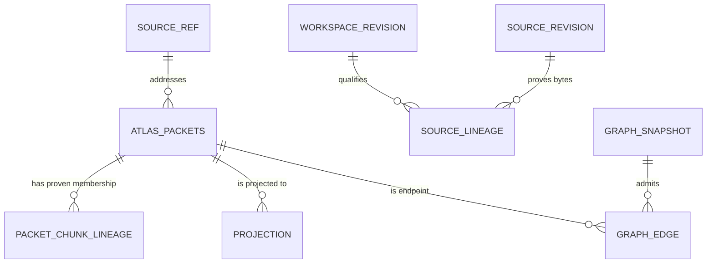
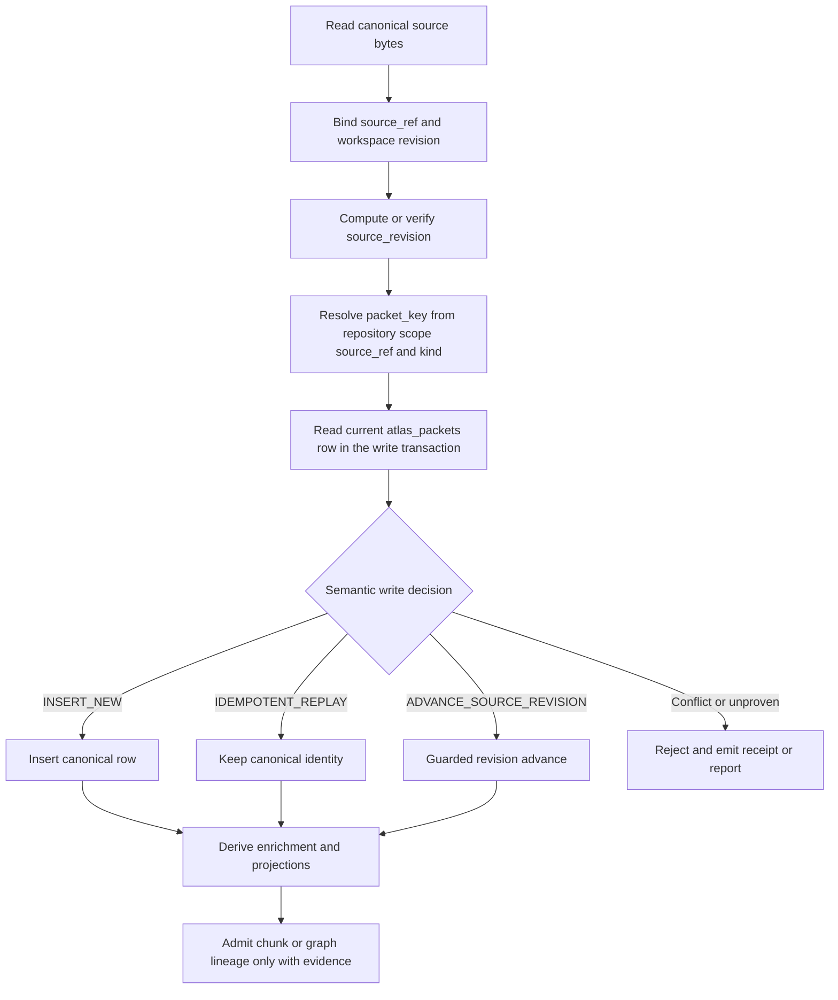

# Packet Identity and Provenance

A **packet** is the file-granularity canonical record addressed by `packet_key`. The current implementation places canonical packet/source state in PostgreSQL `atlas_packets`; Qdrant, graph stores, Redis or Valkey, embeddings, rankings, and other indexes are projections or enrichment. A projection may be useful for retrieval, but it does not mint identity or replace the PostgreSQL row.

> **Status boundary:** `docs/PACKET-CENTRIC-ARCHITECTURE.md` describes a proposed `atlas_packet_registry` as an all-service registry. That is a design proposal, not evidence that the proposed table or its “every service updates the registry atomically” protocol is current. The implementation contracts below make `atlas_packets` the packet/source authority and separate identity from projections. Treat the older registry design as stale or unknown until a migration and writer-ownership contract prove otherwise.

## The identity vocabulary

- **`source_ref`** identifies the canonical source location, normally a repository-relative POSIX path. `workspace-source-binding-v1.ts` owns the source-reference contract. Packet Key V2 rejects non-canonical spellings rather than normalizing them locally; case is preserved. This prevents two spellings of one file from silently producing two identities.
- **`repositoryScope`** is the membership-repository namespace used by Packet Key V2. It must be a `repo:...` membership repository identifier, not the per-row `atlas_packets.repository_id` value or a directory-like workspace name.
- **`packet_kind`** currently has one defined value, `SOURCE_FILE`. A symbol or graph-node packet requires a separate identity contract, not an invented extension of the file key.
- **`packet_key`** is immutable logical identity. Packet Key V2 computes `packet:${UUIDv5(...)}` from exactly `repositoryScope`, canonical `source_ref`, and `packet_kind`. Source revisions, workspace revisions, Qdrant IDs, graph-node keys, ordinals, and `latest`/`current` are forbidden inputs.
- **`source_revision`** is evidence about exact source bytes, normally `sha256:<64 hex characters>`. It qualifies a packet but does not change its key. A packet revision additionally incorporates the packet key, source reference, source revision, content digest, and packet schema revision; workspace, executor, representation, feature, projection, cache, graph, and timestamp metadata are deliberately excluded.
- **`workspace_revision`** identifies the immutable workspace byte set in which processing occurred. **`repository_revision`** is a separate compiler/repository lineage axis and is not a content digest. Neither should be collapsed into `source_revision`.
- **`packet_revision`** qualifies the canonical packet/source content contract. It is distinct from a source revision, which identifies source bytes, and from a workspace revision, which identifies the manifest of the processed workspace.
- **`representation_revision`** qualifies a derived representation such as `semantic_768`; it is not packet identity and is not a substitute for source or workspace proof. Model, tokenizer, input-digest, vector-checksum, and representation revisions belong to representation lineage.
- **Feature and enrichment metadata** (embeddings, labels, summaries, clusters, rerank scores, cache state, and retrieval counters) describe a packet or a representation of it. They are mutable enrichment/projection state, not identity.

Caption: Canonical packets and source lineage remain distinct from chunk membership, graph evidence, and retrieval projections.

## Identity is resolved before representation

Packet Key V2 is deliberately code-only: it performs no datastore read or write. Its `canonicalNameV2()` rejects unknown or forbidden fields and `computePacketKeyV2()` returns a deterministic full UUIDv5 key. `assertCanonicalSourceRefV2()` is a fail-closed check, not a normalizer. Legacy 12-hex keys are compatibility aliases that resolve to a V2 key; they are not a second canonical scheme.

The parent-atlas bridge has a different responsibility at the integration boundary. `extractPacketIdentityFromRow()` extracts the packet triple (`packet_key`, `source_ref`, `feature_id`) from a PostgreSQL row and hard-fails when required fields are missing. `verifyPacketIdentityConsistency()` compares all three fields with an expected identity. `feature_id` is therefore a compatibility validation/envelope field in the bridge; it is not an extra input to Packet Key V2. An envelope can carry trace and payload data only after the identity has been extracted from the canonical row ([canonical-packet-bridge.ts](../../packages/parent-atlas/src/core/canonical-packet-bridge.ts#L29-L43), [canonical-packet-bridge.ts](../../packages/parent-atlas/src/core/canonical-packet-bridge.ts#L57-L110)).

## Revision and authority axes

The `atlas.source-lineage-axes.v1` contract intentionally carries `workspaceRevision`, `repositoryRevision`, and exact `sourceContentRevision` separately. It reports `MATCHED`, `MISSING_BINDING`, or `CONFLICT`; it sets `canonicalAuthority: false` because reconciliation is an observation, not authority selection. A missing or conflicting binding must remain visible as such—do not synthesize a digest or silently choose a revision.

A workspace revision is derived from the sorted source manifest, whose entries bind `sourceRef`, exact content digest, byte length, and source revision. Git commit/tree/blob identifiers are useful provenance anchors, but the manifest digest also changes for dirty, untracked, or renamed sources. Thus the same Git `HEAD` can have a different workspace revision, while a different commit can retain the same workspace revision when the indexed byte manifest is identical. Workspace and source bindings are read-only observations with `canonicalAuthority: false` until a guarded canonical write accepts their evidence ([workspace-source-binding-v1.ts](../../sveltekit-frontend/src/lib/server/atlas/identity/workspace-source-binding-v1.ts#L26-L69), [workspace-source-binding-v1.ts](../../sveltekit-frontend/src/lib/server/atlas/identity/workspace-source-binding-v1.ts#L132-L218)).

The content bridge computes `contentDigest` directly from exact bytes and sets `sourceRevision` to `sha256:${contentDigest}`. Its `readOnlyObservation: true` and `canonicalAuthority: false` flags make clear that a producer observation is evidence for a later guarded write, not a database mutation by itself ([packet-write-decision-v1.ts](../../sveltekit-frontend/src/lib/server/atlas/identity/packet-write-decision-v1.ts#L32-L81)).

### Workspace event state

Workspace event sourcing is a separate state-and-invalidation layer, not a replacement packet identity scheme. A workspace event records a sequence, base snapshot, previous head, new head, before/after checksums, producer revision, and explicit participants. `appendWorkspaceEventV1()` requires the same workspace and base snapshot, the next sequence, the previous head revision, a valid event checksum, and a derived next head revision; stale optimistic appends fail. Invalidations are derived only from participants explicitly marked `INVALIDATES`, and each invalidation is marked `writesPerformed: false` ([workspace-event-sourcing-v1.ts](../../sveltekit-frontend/src/lib/server/atlas/workspace/workspace-event-sourcing-v1.ts#L56-L118), [workspace-event-sourcing-v1.ts](../../sveltekit-frontend/src/lib/server/atlas/workspace/workspace-event-sourcing-v1.ts#L129-L229)). This gives operations a reproducible “what changed and what must be reconsidered” record without allowing an event or invalidation receipt to become packet authority.

## Representation lineage is not source authority

A vector's physical storage coordinate is not proof of its canonical lineage. The semantic representation contract explicitly separates `chunkIndexId` and `storage` from `canonicalChunkId`, `packetKey`, `sourceRevision`, `workspaceRevision`, `representationRevision`, model/tokenizer revisions, input digest, and vector checksum. A row stored in the semantic column can still have `canonicalAuthority: false`.

`REVISION_QUALIFIED` is reached only when the canonical chunk and packet binding, source/workspace revisions, representation/model/tokenizer revisions, a qualified input digest, and vector checksum are all present. `canonicalAuthority: true` is schema-checked against those fields; an `unqualified` input digest cannot qualify a row. Semantic cohort admission is likewise revision-qualified but explicitly non-authoritative and write-free. The V1 contract is retained for historical receipts and must not be silently reinterpreted as the current V2 physical-owner contract ([semantic-representation-v1.ts](../../sveltekit-frontend/src/lib/server/atlas/embedding/semantic-representation-v1.ts#L4-L34), [semantic-representation-v1.ts](../../sveltekit-frontend/src/lib/server/atlas/embedding/semantic-representation-v1.ts#L153-L207), [semantic-representation-v1.ts](../../sveltekit-frontend/src/lib/server/atlas/embedding/semantic-representation-v1.ts#L211-L254)).

## Lifecycle and control flow

Caption: Identity is resolved before enrichment, and every canonical write is classified against freshly read PostgreSQL state.

### Guarded canonical writes

`decidePacketWrite()` is a pure decision layer. The caller must read current canonical state inside the same transaction that applies the write; `ON CONFLICT` or row counts must not be used to infer semantics after the fact. Its precedence is material:

1. A new row requires both `sourceRevision` and `workspaceRevision`; otherwise it is `REVISION_UNPROVEN`.
2. An existing row whose `sourceRef` differs is an `IDENTITY_CONFLICT` and is never repaired automatically.
3. A missing revision is `REVISION_UNPROVEN`.
4. Matching source revisions are checked for content and workspace conflicts; a compatible repeat is `IDEMPOTENT_REPLAY`.
5. A changed source revision is an `ADVANCE_SOURCE_REVISION` only when the caller supplies proof that its expected current revision still matches the row. A stale read is `SOURCE_REVISION_CONFLICT`.

The separate `packet-write-transaction-v1.ts` wrapper shows the intended transaction boundary: read `atlas_packets`, decide, perform a guarded mutation, enqueue a projection outbox event only for a mutation, and write an execution receipt for every decision before commit. It does not call Qdrant, Neo4j, Valkey, or cuVS; a later projector consumes the outbox after commit. This wrapper is explicitly scaffolding and is not yet routed from `semantic-packet-writer.ts`, so do not mistake the contract proof for evidence that every live writer already uses one canonical repository path ([packet-write-transaction-v1.ts](../../sveltekit-frontend/src/lib/server/atlas/identity/packet-write-transaction-v1.ts#L1-L31), [packet-write-transaction-v1.ts](../../sveltekit-frontend/src/lib/server/atlas/identity/packet-write-transaction-v1.ts#L81-L127), [packet-write-transaction-v1.ts](../../sveltekit-frontend/src/lib/server/atlas/identity/packet-write-transaction-v1.ts#L129-L189), [packet-write-transaction-v1.ts](../../sveltekit-frontend/src/lib/server/atlas/identity/packet-write-transaction-v1.ts#L191-L268)).

This makes “same packet, new source bytes” a controlled revision transition rather than an accidental overwrite. It also prevents a producer with no evidence from filling missing revision fields with a plausible placeholder. The live scaffold additionally rejects a checksum-shaped workspace revision when the current storage column can accept only a legacy integer; it must not truncate the revision to `0` ([packet-write-transaction-v1.ts](../../sveltekit-frontend/src/lib/server/atlas/identity/packet-write-transaction-v1.ts#L154-L187)).

## Packet-to-chunk lineage

A file packet is not a chunk. A file with 37 chunks remains one `atlas_packets` row plus up to 37 proven membership rows in `atlas_packet_chunk_lineage`; it must not be reduced to one representative chunk. `canonicalChunkId` must come from an existing `codebase_chunk_index.chunk_id` read at write time. It may not be generated from `source_ref`, a random UUID, a tree-node ID, a Qdrant point ID, or nearest-match inference.

Only proven memberships are admitted. Unresolved or ambiguous candidates belong in receipts/reports or a candidate table. Membership identity is `(packet_key, canonical_chunk_id)`; producer revision and evidence references are provenance on that row, not additional identity. `revisionStatus: UNPROVEN` with a null `sourceRevision` is an honest legacy state, not permission to invent one. A missing `chunkOrdinal` is also allowed: ordering is optional evidence, not identity ([packet-chunk-membership-v1.ts](../../sveltekit-frontend/src/lib/server/atlas/lineage/packet-chunk-membership-v1.ts#L3-L32), [packet-chunk-membership-v1.ts](../../sveltekit-frontend/src/lib/server/atlas/lineage/packet-chunk-membership-v1.ts#L43-L86), [packet-chunk-membership-v1.ts](../../sveltekit-frontend/src/lib/server/atlas/lineage/packet-chunk-membership-v1.ts#L90-L121)).

## Packet-to-graph lineage

A graph snapshot pairs `workspaceRevisionKey` and `graphRevision` with source-revision coverage, producer metadata, and a checksum. `buildGraphRevisionSnapshotFromOwnersV1()` derives the workspace key from the workspace owner and coverage from the graph-source binding receipt, and rejects receipts naming different workspace revisions. The snapshot must not be assembled from current `HEAD` plus a separate graph read.

The graph module classifies an edge candidate; it does not mint packet identity or silently promote partial readback. A candidate receives `ADMISSIBLE` only when both endpoints resolve to exactly one packet, each packet source revision matches the graph's source revision, the candidate's workspace and graph revisions match the one checksum-verified snapshot, and at least one evidence reference is present. Otherwise the classifier returns named failures such as `ENDPOINT_UNRESOLVED`, `ENDPOINT_AMBIGUOUS`, `SOURCE_REVISION_UNBOUND`, `WORKSPACE_REVISION_UNBOUND`, `GRAPH_REVISION_UNBOUND`, or `EVIDENCE_UNBOUND`. Batch summaries count admissible and rejected candidates; they do not imply partial promotion ([graph-revision-snapshot-v1.ts](../../sveltekit-frontend/src/lib/server/atlas/lineage/graph-revision-snapshot-v1.ts#L49-L101), [graph-revision-snapshot-v1.ts](../../sveltekit-frontend/src/lib/server/atlas/lineage/graph-revision-snapshot-v1.ts#L103-L163)).

Packet incidence readback adds a database boundary to this rule. It resolves packet keys against `atlas_packets`, checks the requested workspace snapshot, resolves legacy aliases only to a canonical key, and verifies each lineage row against exact packet IDs, source revisions, workspace and graph revisions, evidence, and both checksums. The exact-revision consumer returns an empty result rather than widening to stale revisions. The incidence contract currently has no persistence writer/table, so a readback proof is an observation and not a new canonical relation ([packet-incidence-postgres-readback-v1.ts](../../sveltekit-frontend/src/lib/server/atlas/lineage/packet-incidence-postgres-readback-v1.ts#L11-L46), [packet-incidence-lineage-v1.ts](../../sveltekit-frontend/src/lib/server/atlas/lineage/packet-incidence-lineage-v1.ts#L131-L180), [packet-incidence-lineage-v1.ts](../../sveltekit-frontend/src/lib/server/atlas/lineage/packet-incidence-lineage-v1.ts#L182-L196)).

## What the current PostgreSQL schema does—and does not—prove

The Drizzle model names `atlas_packets` as the canonical PostgreSQL table, but its mixed legacy/additive shape matters operationally. `source_ref` is required, while `packet_key` remains nullable in the model; `source_revision` is nullable; `content_hash` is distinct from the legacy `sha256`; `workspace_revision` is an integer defaulting to `0`; and `representation_revision` is an integer defaulting to `0`. The same row also carries external coordinates such as `qdrant_point_id`, `neo4j_node_id`, and `tree_node_id`, plus representation lineage fields. These columns provide places to store and validate evidence, but a populated coordinate or default value is not proof that the corresponding lineage is qualified ([atlas-packets.ts](../../sveltekit-frontend/src/lib/server/db/schema/atlas-packets.ts#L30-L44), [atlas-packets.ts](../../sveltekit-frontend/src/lib/server/db/schema/atlas-packets.ts#L65-L85), [atlas-packets.ts](../../sveltekit-frontend/src/lib/server/db/schema/atlas-packets.ts#L102-L140)).

This is why a current contract can require a qualified string revision while a legacy storage path rejects it as incompatible. It is also why `embeddingDigest`, `representationRevision`, and external IDs must not decide packet/source idempotency: the transaction reader uses `content_hash` as source content identity and explicitly keeps vector representation metadata out of that decision ([packet-write-transaction-v1.ts](../../sveltekit-frontend/src/lib/server/atlas/identity/packet-write-transaction-v1.ts#L81-L112)).

## Receipts, observations, and focused tests

Receipts are evidence of an observation, binding, snapshot, membership, or admission decision; they do not become a second authority. Checksums make structured receipts tamper-evident, while producer revisions identify the writer or backfill run. When evidence is absent, record `MISSING_BINDING`, `UNPROVEN`, or a named admission failure instead of guessing.

Focused contracts and tests worth running before changing indexing or retrieval include:

- **Key and aliases:** [`packet-key-v2.ts`](../../sveltekit-frontend/src/lib/server/atlas/identity/packet-key-v2.ts#L27-L95), [`packet-key-v2.spec.ts`](../../sveltekit-frontend/src/lib/server/atlas/identity/packet-key-v2.spec.ts#L17-L97), [`packet-key-resolution-v2.ts`](../../sveltekit-frontend/src/lib/server/atlas/identity/packet-key-resolution-v2.ts), [`packet-key-resolution-v2.spec.ts`](../../sveltekit-frontend/src/lib/server/atlas/identity/packet-key-resolution-v2.spec.ts), and [`packet-key-dominant-scheme.spec.ts`](../../sveltekit-frontend/src/lib/server/atlas/identity/packet-key-dominant-scheme.spec.ts) cover deterministic dimensions, rejected forbidden inputs, fail-closed source spelling, and legacy alias resolution.
- **Source and workspace axes:** [`workspace-source-binding-v1.ts`](../../sveltekit-frontend/src/lib/server/atlas/identity/workspace-source-binding-v1.ts#L26-L69), [`workspace-source-binding-v1.spec.ts`](../../sveltekit-frontend/src/lib/server/atlas/identity/workspace-source-binding-v1.spec.ts#L40-L148), [`source-lineage-axes-v1.ts`](../../sveltekit-frontend/src/lib/server/atlas/identity/source-lineage-axes-v1.ts#L9-L92), [`source-lineage-axes-v1.spec.ts`](../../sveltekit-frontend/src/lib/server/atlas/identity/source-lineage-axes-v1.spec.ts), and [`packet-digest-bridge-v1.spec.ts`](../../sveltekit-frontend/src/lib/server/atlas/identity/packet-digest-bridge-v1.spec.ts) cover exact bytes, dirty/renamed sources, distinct axes, conflicts, and checksum/read-only semantics.
- **Packet revision and writes:** [`packet-revision-v1.ts`](../../sveltekit-frontend/src/lib/server/atlas/identity/packet-revision-v1.ts#L13-L66), [`packet-revision-v1.spec.ts`](../../sveltekit-frontend/src/lib/server/atlas/identity/packet-revision-v1.spec.ts#L21-L59), [`packet-write-decision-v1.ts`](../../sveltekit-frontend/src/lib/server/atlas/identity/packet-write-decision-v1.ts#L132-L238), [`packet-write-decision-v1.spec.ts`](../../sveltekit-frontend/src/lib/server/atlas/identity/packet-write-decision-v1.spec.ts#L70-L170), and [`packet-write-transaction-v1.ts`](../../sveltekit-frontend/src/lib/server/atlas/identity/packet-write-transaction-v1.ts#L129-L268) cover excluded metadata, replay, revision advance, stale reads, conflicts, receipts, and outbox separation.
- **Representation lineage:** [`semantic-representation-v1.ts`](../../sveltekit-frontend/src/lib/server/atlas/embedding/semantic-representation-v1.ts#L153-L207), [`semantic-representation-v1.spec.ts`](../../sveltekit-frontend/src/lib/server/atlas/embedding/semantic-representation-v1.spec.ts#L14-L145), and the current V2 owner referenced by that contract should be run when changing vector dimensions, model/tokenizer revisions, input digests, or representation admission.
- **Workspace state:** [`workspace-event-sourcing-v1.ts`](../../sveltekit-frontend/src/lib/server/atlas/workspace/workspace-event-sourcing-v1.ts#L142-L229) and [`workspace-event-sourcing-v1.spec.ts`](../../sveltekit-frontend/src/lib/server/atlas/workspace/workspace-event-sourcing-v1.spec.ts#L42-L69) cover checksummed optimistic appends and explicit packet/representation invalidations.
- **Chunk and graph lineage:** [`packet-chunk-membership-v1.ts`](../../sveltekit-frontend/src/lib/server/atlas/lineage/packet-chunk-membership-v1.ts#L43-L121), [`packet-chunk-membership-v1.spec.ts`](../../sveltekit-frontend/src/lib/server/atlas/lineage/packet-chunk-membership-v1.spec.ts#L19-L125), [`graph-revision-snapshot-v1.ts`](../../sveltekit-frontend/src/lib/server/atlas/lineage/graph-revision-snapshot-v1.ts#L49-L163), and [`graph-revision-snapshot-v1.spec.ts`](../../sveltekit-frontend/src/lib/server/atlas/lineage/graph-revision-snapshot-v1.spec.ts#L22-L92) cover canonical chunk ownership, honest unproven states, snapshot tampering, endpoint ambiguity, and no partial promotion.
- **End-to-end provenance:** [`repository-provenance-workflow.ts`](../../sveltekit-frontend/src/lib/server/atlas/repository-provenance-workflow.ts#L96-L228), its stage execution and artifact writes ([`repository-provenance-workflow.ts`](../../sveltekit-frontend/src/lib/server/atlas/repository-provenance-workflow.ts#L890-L1280)), and [`repository-provenance-workflow.spec.ts`](../../sveltekit-frontend/src/lib/server/atlas/repository-provenance-workflow.spec.ts#L36-L83) cover snapshot, inventory, structural identity, lexical and semantic enrichment, relationships, projections, validation, evaluation, and incremental reuse reporting.

When changing a field used by indexing or retrieval, use this order: identify whether it is identity, source/revision evidence, mutable enrichment, or projection metadata; confirm its PostgreSQL owner; preserve the old key and add a versioned contract if identity rules change; run the focused identity/write/lineage tests; then rebuild projections from canonical rows. Do not update Qdrant, graph, or cache identifiers first and attempt to reconcile PostgreSQL afterward.

## Evidence boundaries and known conflicts

The older data-spine proposal describes SHA-256 IDs based on a normalization routine that lowercases paths and strips prefixes. That conflicts with the current Packet Key V2 contract, which requires an already canonical upstream `source_ref`, preserves case, and uses UUIDv5 over repository scope plus source ref plus packet kind. Until an explicit migration establishes otherwise, the older normalization rule is **stale/unknown**, not a rule to reconcile silently.

Likewise, the packet-centric architecture's “every service updates the registry atomically” pattern is a useful target architecture but does not override PostgreSQL `atlas_packets` authority or the guarded write and lineage contracts. External stores should be treated as rebuildable projections unless a current schema and owner contract proves a stronger guarantee.

For related operational guidance, see [Packet Registry](./packet-registry.md), [Safe Rebuilds and Failure Handling](../operations/safe-rebuilds-and-failure-handling.md), [Contracts and Boundaries](../testing/contracts-and-boundaries.md), and [Graphify Ingestion](../workflows/graphify-ingestion.md).

### Repository anchors

- `packages/parent-atlas/src/core/canonical-packet-bridge.ts`
- `sveltekit-frontend/src/lib/server/db/schema/atlas-packets.ts`
- `sveltekit-frontend/src/lib/server/atlas/identity/packet-key-v2.ts`
- `sveltekit-frontend/src/lib/server/atlas/identity/packet-revision-v1.ts`
- `sveltekit-frontend/src/lib/server/atlas/identity/source-lineage-axes-v1.ts`
- `sveltekit-frontend/src/lib/server/atlas/identity/workspace-source-binding-v1.ts`
- `sveltekit-frontend/src/lib/server/atlas/identity/packet-write-decision-v1.ts`
- `sveltekit-frontend/src/lib/server/atlas/identity/packet-write-transaction-v1.ts`
- `sveltekit-frontend/src/lib/server/atlas/lineage/packet-chunk-membership-v1.ts`
- `sveltekit-frontend/src/lib/server/atlas/lineage/graph-revision-snapshot-v1.ts`
- `sveltekit-frontend/src/lib/server/atlas/lineage/packet-incidence-lineage-v1.ts`
- `sveltekit-frontend/src/lib/server/atlas/workspace/workspace-event-sourcing-v1.ts`
- `sveltekit-frontend/src/lib/server/atlas/embedding/semantic-representation-v1.ts`
- `sveltekit-frontend/src/lib/server/atlas/repository-provenance-workflow.ts`
